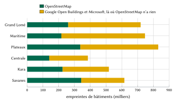
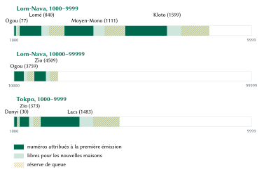
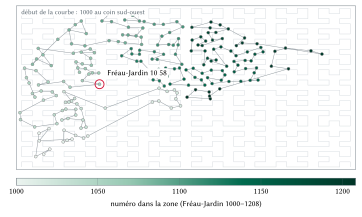
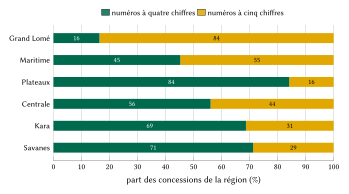

**Mots clés :** adressage ; codes postaux ; Togo ; courbe de Hilbert ; chiffres de contrôle ; empreintes de bâtiments ; infrastructure de données spatiales.

# Introduction

L'adresse est un bien public d'une nature particulière : elle vaut peu pour le ménage qui la détient et beaucoup pour tous ceux qui doivent le trouver. Là où elle manque, le coût est payé en petites sommes par un grand nombre de personnes, dans les appels du livreur, les minutes perdues par l'ambulance ou la facture que le service d'eau ne parvient pas à remettre, et il est rarement mesuré. L'étude de la Banque mondiale sur l'adressage des villes africaines constatait que plus de la moitié des rues de la région n'avaient pas de nom et que les programmes d'adressage se dégradent lorsque les habitants ne s'en servent pas [@farvacque2005]. L'Union postale universelle considère l'adresse comme une infrastructure de base, au même titre que la route ou l'électricité [@upu2012addressing].

Le Togo en offre un exemple net. Le pays n'a pas de code postal [@upu2005togo; @usps2025togo] et le courrier est remis dans des boîtes postales. L'ancienne commune de Lomé dispose depuis 1997 de rues codées, que le District Autonome du Grand Lomé (DAGL) modernise avec des numéros d'entrée qui n'étaient pas encore publiés au moment où nous écrivons [@togopresse2025; @rot2026bonneadresse]. Ailleurs, y compris dans la plus grande partie du Grand Lomé, on trouve une maison par son quartier, un point de repère et un coup de téléphone.

Cet article apporte quatre contributions.

1. Un **modèle** dans lequel chaque concession du Togo reçoit un code court, que l'on peut dire et retenir : un nom de lieu et deux paires de chiffres. Le code est unique dans tout le pays à lui seul, propriété obtenue en donnant à chaque nom de lieu une plage nationale de numéros (section 5).
2. Une **spécification mathématique** complète : affectation aux zones, noms de plaque, normalisation des noms, attribution des blocs, numérotation le long d'une courbe de Hilbert, insertion des nouvelles concessions, décodage, chiffre de contrôle et grille pour les points qui ne sont pas des concessions, chacun avec un exemple calculé sur un code réel (section 5).
3. Une **mise en œuvre** ouverte : un moteur de référence et ses vecteurs de conformité, le registre des 2 768 053 codes et un serveur que tout organisme public peut déployer pour répondre exactement comme l'émetteur (section 6).
4. Une **évaluation** des propriétés mesurées des codes émis (section 7) et des conceptions écartées (section 8), suivie d'une analyse des bénéfices pour les citoyens, la logistique, les secours et l'administration, chacune avec des hypothèses explicites (sections 9 à 12).

La section 2 passe en revue les systèmes d'adressage, postaux et fonciers existants au Togo ainsi que la pratique internationale ; la section 3 décrit les données ; la section 4 énonce les exigences de conception. Les sections 13 et 14 traitent de la protection des données, de la gouvernance et des limites, et la section 15 conclut.

# Contexte et travaux existants

## Le Togo : territoire, population et administration

Le cinquième recensement général de la population et de l'habitat (RGPH-5, novembre 2022) a dénombré 8 095 498 habitants, dont 42,9 % en milieu urbain [@inseed2023rgph5; @koaci2023rgph5]. Le Grand Lomé comptait 2 188 376 habitants, 1 305 681 dans la préfecture du Golfe et 882 695 dans celle d'Agoè-Nyivé [@koaci2023rgph5]. Le pays forme une bande d'environ 600 km du golfe de Guinée au Sahel, ses villes s'égrenant le long de la route nationale : Lomé sur la côte, puis Tsévié, Atakpamé, Sokodé, Kara et Dapaong (figure 1).

Le pays compte cinq régions (Maritime, Plateaux, Centrale, Kara et Savanes) et le District autonome du Grand Lomé, 39 préfectures, 117 communes et environ 394 cantons, chefferies traditionnelles que chacun connaît par leur nom. Le français est la langue officielle ; l'éwé au sud et le kabiyè au nord sont langues nationales. Les numéros de téléphone se disent en français et par paires (« quatre-vingt-dix, douze, trente-quatre, cinquante-six »), habitude sur laquelle repose le modèle.

{#fig:density width=50%}

## L'adressage postal

La fiche d'adressage de l'UPU pour le Togo donne un nom, un numéro de boîte et une ville (« B.P. 526, LOME, TOGO »), sans champ pour un code postal [@upu2005togo]. À Lomé, un préfixe de bureau précède la boîte et suit la ville (« 01 BP 2274 Lomé 01 »). En juin 2025, la Société des Postes du Togo (SPT) a demandé aux expéditeurs étrangers d'ajouter le téléphone et l'adresse électronique du destinataire, non un code postal [@usps2025togo]. L'application PostMap de la SPT évoque « le code postal d'une adresse » sans en publier le format [@spt2024postmap]. Une boîte désigne un guichet, non une porte ; le modèle la conserve comme une ligne de texte libre.

## Les codes de rue de Lomé

L'ancienne commune de Lomé est divisée en 69 quartiers, chacun doté d'un code de deux ou trois caractères : AMT pour Amoutivé, BE pour Bè, HDN pour Hédzranawoé, FRJ pour Fréau-Jardin [@osmwikilome]. Une rue porte un numéro et le code de son quartier, ce qui s'écrit « Rue Oukata-Waya 165 AMT », « Avenue de la Présidence 13.QAD » ou « Rue Batemoni 46BE ». Beaucoup de rues portent aussi un nom. Environ un quart des rues de Lomé sont nommées dans OpenStreetMap avec leur code. Un code de rue désigne une rue, non un portail.

## La modernisation du Grand Lomé

Le 17 décembre 2025, le DAGL et la société Edenmap ont restitué, dans le cadre du Projet Environnement Urbain de Lomé financé par l'Agence française de développement, les bases d'adresses actualisées des 13 communes du Grand Lomé [@togopresse2025]. Les voies sont codées puis dénommées ; les points d'adresse suivent le système métrique et sont rattachés à un numéro d'entrée ; les plaques portent ce numéro et le code ou le nom de la voie [@rot2025modernisation]. Environ 500 000 adresses sont à créer sur 16 000 voies recensées, dont près de 13 000 restent à dénommer [@rot2026bonneadresse]. Un volet citoyen avec Togo Digital est prévu. En octobre 2026, ni format, ni calendrier, ni jeu de données ouvert n'avaient été publiés. Un projet de décret sur l'adressage des voies et places publiques a été adopté le 7 juillet 2022 ; l'adressage est une compétence partagée entre l'État et les collectivités territoriales [@gouv2022decret].

## L'enregistrement foncier

Le foncier relève de l'Office Togolais des Recettes, et une propriété immatriculée est désignée par son titre foncier. Le code foncier dispose que le cadastre « ne peut faire perdre ni conférer un droit de propriété » (art. 33) [@loi2018005]. Une adresse et un titre foncier répondent à des questions différentes : le modèle n'utilise jamais une référence foncière comme adresse et ne laisse jamais entendre un droit sur le sol.

## La pratique internationale

La norme S42 de l'UPU décrit les éléments d'une adresse postale et les gabarits selon lesquels chaque pays les ordonne [@upuS42] ; elle suppose que ces éléments existent. Le manuel de la Banque mondiale décrit comment une ville nomme ses rues et numérote ses portes, en général selon une règle métrique le long de chaque voie, pour un coût moyen estimé à 5,7 dollars américains par porte aux prix de 2005 [@farvacque2005]. Les deux démarches partent de la rue. Or la plupart des concessions togolaises ne donnent sur aucune rue nommée, et les rues du Grand Lomé sont en cours de dénomination par le DAGL ; un code national ne peut attendre ce travail, mais il doit lui faire place.

## Les codes de grille et leurs limites

Une seconde famille de systèmes encode des coordonnées. L'Open Location Code (Plus Codes) écrit la latitude et la longitude dans un alphabet de base 20 ; la concession voisine du Grand Marché de Lomé y devient 6FR346JF+P9 [@olc]. La SPT a lancé en 2020 un appel à manifestation d'intérêt pour les Plus Codes et avait annoncé auparavant un système en trois mots [@togofirst2019w3w] ; aucun des deux n'est en usage. Au Ghana, le système national d'adressage numérique des propriétés lancé en 2017 attribue à chaque carré de 5 m un code formé d'un préfixe de district et de chiffres [@citifm2017ghanapost]. Une application privée togolaise, TogoLink, délivre des codes GPS de cinq à sept caractères, tous droits réservés.

Les codes de grille ont de vrais mérites : ils ne demandent aucun relevé et fonctionnent hors connexion. Leur faiblesse, pour notre usage, est qu'ils désignent un carré et non un foyer. Le code d'une concession dépend de l'endroit où tombe son point de référence, deux ménages d'une même concession partagent une maille, et le code ne contient aucun mot que les gens disent déjà. Les lettres prononcées en français, en éwé et en kabiyè sont source d'erreurs : le Q n'existe dans aucune des deux langues nationales, et W et V s'épellent en français. Nous gardons donc une grille pour les points qui ne sont pas des concessions (section 5.10) et donnons aux foyers un code fait d'un nom et de chiffres.

## L'adresse officielle d'abord

Une règle prime sur toutes les autres : là où l'État donne une adresse, elle est affichée en premier, exactement comme l'État l'écrit. Dans l'ancienne commune de Lomé, la rue officielle située à moins de 30 m de la concession figure en tête de chaque fiche (« Rue Mission Tové, Lomé ») ; 71 002 concessions en ont une. Lorsque les adresses d'entrée du DAGL sont partagées ou qu'un habitant confirme la plaque de son portail, l'adresse du DAGL est rattachée à la concession et remplace la rue ; aucun code N-Ways ne change. Le code N-Ways se tient à côté de l'adresse officielle : il se dit au téléphone et distingue les ménages qui partagent un portail. Partout ailleurs, aucune adresse officielle n'existe au niveau de la porte, et le code N-Ways est l'adresse.

# Données et sources

Le modèle est calculé uniquement à partir de données ouvertes (tableau 1).

- **OpenStreetMap** : empreintes de bâtiments, murs, clôtures et haies, portails, noms de lieux, quartiers de Lomé avec leurs codes officiels et rues nommées de Lomé, d'après l'extrait Geofabrik du 17 octobre 2026 [@geofabrik2026; @haklay2008osm].
- **Les empreintes Google Open Buildings et Microsoft**, via la publication des bâtiments d'Overture Maps, qui donne la priorité à OpenStreetMap et complète par des empreintes détectées automatiquement là où OpenStreetMap n'a rien [@overture2026buildings; @sirko2021openbuildings; @microsoft2023footprints].
- **Les limites de cantons** : les 373 cantons du jeu de données opérationnel commun de HDX (COD-AB, valable au 7 janvier 2021, CC BY-IGO) [@hdx2021cod]. Les 117 communes n'ont pas de limites ouvertes.
- **La population** : les totaux du RGPH-5 [@inseed2023rgph5].

| Région | Concessions | Empreintes | Issues d'OpenStreetMap | Empreinte médiane |
|:--|--:|--:|--:|--:|
| Plateaux | 648 943 | 831 095 | 336 199 | 30,9 m² |
| Maritime | 590 823 | 746 954 | 216 701 | 40,4 m² |
| Grand Lomé | 545 465 | 719 517 | 259 523 | 51,6 m² |
| Savanes | 348 082 | 616 305 | 342 505 | 19,1 m² |
| Kara | 336 577 | 517 963 | 224 108 | 27,6 m² |
| Centrale | 298 163 | 384 919 | 139 729 | 31,3 m² |
| **Togo** | **2 768 053** | **3 816 753** | **1 518 765** | **39,4 m²** |

: Concessions et empreintes de bâtiments par région. {#tbl:regions}

Sur les 3 816 753 empreintes, 1 518 765 (39,8 %) proviennent d'OpenStreetMap et 2 297 988 des jeux détectés automatiquement (figure 2). OpenStreetMap est le plus complet dans les Savanes, où il fournit 56 % des empreintes, et le moins dans la région Maritime et le Grand Lomé. L'attribut de hauteur des empreintes détectées automatiquement ne prend que 36 valeurs distinctes entre 3,5 et 7 m ; il n'est pas utilisé. OpenStreetMap donne le nombre de niveaux de 398 bâtiments.

{#fig:sources width=88%}

# Exigences de conception

Nous avons fixé et hiérarchisé les exigences avant la conception, afin que tout conflit entre deux d'entre elles ait une réponse.

1. **Facile à retenir et à donner.** Un code est un nom de lieu déjà en usage et deux paires de chiffres ; l'obtenir demande un seul geste dans l'application.
2. **Unique dans tout le pays à lui seul.** Ni préfecture, ni commune, ni position du téléphone ne doivent être nécessaires pour le décoder.
3. **La concession et son portail.** L'unité est la parcelle ou la cour ; les bâtiments en sont des sous-unités ; la navigation s'arrête au portail.
4. **L'officiel d'abord**, partout où une adresse officielle existe (section 2.8).
5. **Jamais confondu avec un code officiel.** Un code commence par un nom et compte quatre ou cinq chiffres ; il ne ressemble donc jamais à un code de rue de Lomé (« 165 AMT ») ni à une boîte postale.
6. **Utilisable hors connexion.**
7. **Stable.** Un code ne bouge jamais et n'est jamais réattribué.
8. **Des lieux, jamais des personnes.**
9. **Ouvert et transférable à l'État.**

# Le modèle

## Les formes d'un code

Un code se présente sous plusieurs formes, chacune destinée à un lecteur différent (tableau 2). Pour une zone de nom de plaque $P$ et de clé $K$, et un numéro $N$ de quatre ou cinq chiffres,

$$
R = P \mathbin{\smile} \pi(N), \qquad M = \texttt{TG-}K\texttt{-}N\texttt{-}c,
\tag{1}
$$

où $R$ est la forme retenue, $M$ la forme machine, $c$ le chiffre de contrôle de la section 5.9, $\smile$ la juxtaposition avec une espace, et $\pi$ le découpage des chiffres en paires à partir de la droite : $\pi(1058)$ donne « 10 58 » et $\pi(14198)$ donne « 1 41 98 ».

| Forme | Exemple | Utilisée par |
|:--------------|:------------------------------|:------------------------------|
| Retenue | Fréau-Jardin 10 58 (« Fréau-Jardin, dix, cinquante-huit ») | les personnes : dite, tapée, écrite sur un colis |
| Machine | TG-FRJ-1058-2 | applications, codes QR, systèmes partenaires ; le dernier chiffre est un contrôle, réservé aux systèmes |
| Bâtiment, entrée | TG-FRJ-1058-2.2/1 | un bâtiment de la concession ; l'un de ses portails |
| Point | FRJ-54-4R | tout point : un étal, un champ, un accident sur la route |
| Officielle, à Lomé | Rue Mission Tové, Lomé | l'adresse de l'État, affichée en premier |

: Les formes d'un même code. {#tbl:forms}

Personne ne voit, ne tape ni ne dit le chiffre de contrôle. Les plaques et les formes écrites ne portent que le nom et le numéro.

## Les zones de code

Une **zone de code** est un lieu que les gens nomment. Il en existe trois sortes (tableau 3). Les quartiers de Lomé sont les quartiers officiels, avec leurs codes officiels pour clés [@osmwikilome]. Hors de Lomé, l'unité est le canton : les 117 communes n'ont pas de limites ouvertes, et les 39 préfectures sont trop grandes pour des numéros courts (le Zio compte à lui seul environ 280 000 bâtiments). Un canton trop grand pour des numéros à quatre chiffres est divisé en cellules autour des lieux nommés qu'il contient.

| Sorte | Nombre | Clé | Exemple |
|:------------------------------|------:|:---------------------|:---------------------|
| Quartier de l'ancienne commune de Lomé | 69 | le code officiel du quartier | FRJ Fréau-Jardin |
| Canton entier | 215 | préfecture (3 lettres) et 2 chiffres | KOZ14 |
| Cellule de lieu nommé d'un canton divisé | 1 095 | clé du canton et 2 chiffres | KOZ0615 Zongo, à Kara |

: Les sortes de zones de code. {#tbl:areas}

Une empreinte $f$ de latitude $\varphi_f$ et de longitude $\lambda_f$ appartient au quartier qui la contient, sinon à son canton ; si le canton est divisé, à la cellule $c$ dont le lieu nommé est le plus proche. Les distances utilisent les longueurs locales d'un degré de latitude et de longitude sur l'ellipsoïde WGS 84,

$$
m_\varphi = 111\,132{,}92 - 559{,}82\cos 2\varphi + 1{,}175\cos 4\varphi, \qquad
m_\lambda = 111\,412{,}84\cos\varphi - 93{,}5\cos 3\varphi
\tag{2}
$$

en mètres par degré, et la cellule est

$$
\operatorname{cellule}(f) = \operatorname*{arg\,min}_{c}\; \sqrt{\big((\varphi_f-\varphi_c)\,m_\varphi\big)^2 + \big((\lambda_f-\lambda_c)\,m_\lambda\big)^2 }.
\tag{3}
$$

Sur les 1 379 zones, 1 371 contiennent des concessions. La zone médiane en compte 1 075 et la plus grande, le canton de Sagbado dans le Golfe, 41 259 (figure 3). Chaque zone est figée à la première émission : son indice, sa clé, ses blocs de numéros et son **cadre**, le rectangle englobant sur lequel ses numéros sont disposés.

{#fig:sizes width=92%}

## Les noms de plaque

Un nom qui ne tient ni sur une plaque ni dans un souffle n'est pas retenu ; on abrège « Gboto Koissidamé » en « Koissidamé ». Chaque zone a donc un nom officiel et un **nom de plaque**. Soit $\mathrm{NFC}(s)$ la chaîne en forme normale Unicode C, $\operatorname{mots}(s)$ ses mots (le trait d'union sépare deux mots) et $L = \{$de, du, des, d', la, le, les, l', et, sur, en, au, aux, à$\}$ l'ensemble des mots qui ne comptent pas. Alors

$$
\operatorname{plaque}(s) \iff |\mathrm{NFC}(s)| \le 12 \;\wedge\; |\operatorname{mots}(s) \setminus L| \le 2 \;\wedge\; s \text{ ne contient aucun chiffre}.
\tag{4}
$$

Un nom qui ne satisfait pas l'éq. (4) passe par des étapes fixes, et la première qui réussit est retenue. Le nom est d'abord nettoyé : le texte entre parenthèses ou après une barre oblique et les mots génériques comme Zone, Quartier, Village, Résidence ou Cité disparaissent (« Zone Portuaire » devient *Portuaire*, « Dako/Daoude » devient *Dako*). Sinon, on prend la suite de mots entiers la plus distinctive lorsqu'elle se détache nettement, de préférence à la fin du nom, où se trouve d'ordinaire la partie propre (« Adjahun Fiagbe » devient *Fiagbe*). Un mot n'est jamais coupé. Certains mots ne sont jamais supprimés automatiquement : en éwé et en mina, *kopé*, *kondji* et *kodzi* signifient village et *kpota* la périphérie, si bien qu'« Aklassou kopé » est un village à part entière. Un nom de plaque ne peut être égal au chef-lieu d'une préfecture, à un quartier de Lomé ou à une ville connue de l'autre côté de la frontière, sauf s'il s'agit de la zone elle-même.

| Noms de plaque | Zones |
|:--|--:|
| Nom officiel conservé tel quel | 1 253 |
| Nettoyé | 17 |
| Réduit à ses mots distinctifs | 33 |
| Provisoire, proposé à la commune | 76 |
| **Total** | **1 379** |

: Origine des noms de plaque. {#tbl:plates}

Sur les 1 379 noms officiels, 122 dépassent la limite. Soixante-seize zones portent un nom de plaque provisoire, le premier de trois candidats au plus, que leur commune peut remplacer une fois : 38 joignent deux noms par un trait d'union, 25 sont des mots uniques de plus de 12 lettres, 9 perdraient un qualificatif comme *kopé* ou *haut*, 2 seraient égaux à une ville connue et 2 n'offrent pas de choix clair. Leurs 145 645 codes sont émis ; un choix ultérieur change le nom, jamais le numéro. Un nom à trait d'union propose d'abord sa partie la plus rare : « Agoè-Démakpoè » propose *Démakpoè*, car « Agoè » commence quatre noms de zones. Le nom officiel demeure un alias (95 alias en tout), si bien que taper le nom complet mène à la même concession.

## La clé de nom

Deux graphies d'un même nom doivent se décoder de la même façon. La **clé de nom** est la composition

$$
\operatorname{clé}(s) = \operatorname{plier}\circ\operatorname{sans\_parties}\circ\operatorname{sans\_article}\circ\operatorname{maj}\circ\operatorname{sans\_accents}\circ\operatorname{éwé}(s),
\tag{5}
$$

dont les étapes figurent au tableau 5.

| Étape | Règle | Exemple |
|:-------------------|:--------------------------------|:----------------------|
| éwé | ɛ ɔ ŋ ƒ ʋ ɖ ɣ deviennent e o n f v d g | Kpɔta → Kpota |
| sans\_accents, maj | accents et casse supprimés ; tout caractère autre qu'une lettre ou un chiffre devient une espace | Agoè-Nyivé → AGOE NYIVE |
| sans\_article, sans\_parties | un le, la, les ou l' initial et les numéros de partie finaux (1, 2, I–IV) supprimés | Zongo 1 → ZONGO |
| plier | espaces supprimées ; PH → F, QU → K, DJ → J, OU → U, W → U ; C devant A, O, U ou en finale → K ; lettres doublées simplifiées | Djanta Copé, Djanta kopé → JANTAKOPE |

: Les étapes de la clé de nom, éq. (5). {#tbl:key}

Le pliage ne peut que fusionner des noms, jamais en séparer un : une erreur de pliage coûte au pire une plage partagée, jamais un code perdu. Les 1 379 zones portent 1 323 clés de nom ; 50 clés sont partagées par 106 zones totalisant 240 136 concessions. Lom-Nava apparaît six fois ; Kamina et Tokpo trois fois ; Zongo, Amoutivé, Akodésséwa et Sanguéra deux fois.

## Une plage nationale par nom

Chaque clé de nom possède, à l'échelle nationale, les numéros 1000 à 9999 et 10000 à 99999. Une zone de $c$ concessions reçoit un bloc de

$$
b(c) = \max\!\left(200,\; 100\left\lceil \frac{2c}{100}\right\rceil\right)
\tag{6}
$$

numéros : le double de ses concessions, en centaines entières, au moins 200. Les zones d'un même nom sont placées par taille de bloc croissante, puis par indice de zone. Soit $u$ le plus grand numéro déjà utilisé dans la partie concernée de la plage du nom ; un bloc est placé en

$$
[\,lo, hi\,] =
\begin{cases}
[\,u_4+1,\; u_4+b\,] & \text{si } u_4 + b \le 9999,\\[2pt]
[\,u_5+1,\; u_5+b\,] & \text{sinon, si } 99999 - (u_5+b) \ge 5000,\\[2pt]
\text{un qualificatif est nécessaire} & \text{sinon,}
\end{cases}
\tag{7}
$$

où $u_4$ part de 999 et $u_5$ de 9999. Un bloc à quatre chiffres et un bloc à cinq chiffres ne se mélangent jamais, et chaque nom garde au moins 5 000 numéros libres pour de futures zones du même nom. Aucun nom n'a eu besoin d'un qualificatif.

*Exemple : Fréau-Jardin.* Une zone, 209 concessions : $b(209) = \max(200, 100\lceil 4{,}18\rceil) = 500$, d'où le bloc 1000–1499.

*Exemple : Tokpo*, trois zones distantes de 140 km au plus (figure 4). Danyi, 30 concessions : $b = 200$, bloc 1000–1199. Zio, 373 concessions : $b = 800$, bloc 1200–1999. Lacs, 1 483 concessions : $b = 3000$, bloc 2000–4999. « Tokpo 11 00 » se trouve dans le Danyi et « Tokpo 24 17 » dans les Lacs ; « Tokpo 54 17 » n'appartient à aucun bloc et est refusé.

*Exemple : Lom-Nava*, le nom le plus répété. Quatre blocs tiennent dans la partie à quatre chiffres : Ogou (77 concessions, 1000–1199), le quartier de Lomé (840, 1200–2899), le Moyen-Mono (1 111, 2900–5199) et le Kloto (1 599, 5200–8399). Le cinquième, le canton de l'Ogou avec 3 759 concessions, demande 7 600 numéros, qui ne tiennent plus sous 9999 ; il ouvre la partie à cinq chiffres en 10000–17599, suivi du Zio (4 509, 17600–26699).

{#fig:blocks width=100%}

À la première émission, 1 251 zones ont des numéros à quatre chiffres et 128 à cinq. En concessions, 1 549 299 (56,0 %) ont quatre chiffres et 1 218 754 (44,0 %) cinq. Les cinq chiffres se concentrent dans les grands cantons du Grand Lomé (Sagbado, Legbassito, Togblékopé, Klémé) et dans les villes de l'intérieur cartographiées par un seul point (Sokodé, Tsévié, Dapaong) ; la figure 7 donne les parts par région. Une nouvelle zone d'un nom existant, ou une zone dont le bloc est plein, reçoit le bloc suivant, au-dessus de tous les blocs de son nom ; les blocs ne bougent, ne rétrécissent ni ne sont renumérotés.

## La numérotation dans une zone : la courbe de Hilbert

Dans une zone, les concessions sont numérotées le long d'une courbe de Hilbert [@hilbert1891] d'ordre 16 posée sur le cadre figé de la zone $(x_0, y_0, x_1, y_1)$, au point de référence de chaque concession : le centre de son bâtiment principal tant qu'aucun portail n'est confirmé. La courbe de Hilbert préserve la proximité mieux qu'un balayage ligne par ligne ou qu'une courbe en Z [@moon2001hilbert] : des concessions voisines reçoivent des numéros voisins, et le livreur qui connaît un numéro sait à peu près où se trouve le suivant. Le point $(\varphi, \lambda)$ devient les coordonnées entières

$$
g_x = \left\lfloor \frac{\lambda - x_0}{x_1 - x_0}\,(2^{16}-1) \right\rfloor, \qquad
g_y = \left\lfloor \frac{\varphi - y_0}{y_1 - y_0}\,(2^{16}-1) \right\rfloor .
\tag{8}
$$

L'indice de Hilbert $h$ s'accumule sur les échelles $s = 2^{15}, 2^{14}, \dots, 1$. Avec $r_x = [\,g_x \wedge s \ne 0\,]$ et $r_y = [\,g_y \wedge s \ne 0\,]$ à chaque échelle,

$$
h = \sum_{s} s^2 \big( (3 r_x) \oplus r_y \big),
\tag{9}
$$

où, après chaque terme, le quadrant est tourné : si $r_y = 0$, alors $(g_x, g_y) \leftarrow (2^{16}-1-g_x,\, 2^{16}-1-g_y)$ lorsque $r_x = 1$, puis $(g_x, g_y) \leftarrow (g_y, g_x)$. Les $n$ concessions d'une zone de bloc $[lo, hi]$ et de capacité $C = hi - lo + 1$ sont triées selon $(h, \text{identifiant stable})$ et reçoivent

$$
N_i = lo + i\,\sigma, \qquad \sigma = \max\!\left(1, \left\lfloor \frac{C}{1{,}5\,n} \right\rfloor\right), \qquad i = 0, \dots, n-1,
\tag{10}
$$

de sorte que $\sigma - 1$ numéros libres suivent chaque concession. Le tiers supérieur du bloc est mis de côté comme **réserve de queue**, qui commence en

$$
t = lo + \left\lfloor \tfrac{2}{3}\, C \right\rfloor .
\tag{11}
$$

*Exemple : Fréau-Jardin 10 58.* Le point de référence de la concession est $\varphi = 6{,}1317765$, $\lambda = 1{,}2234008$, et le cadre de Fréau-Jardin est $(1{,}22204\,;\ 6{,}13038\,;\ 1{,}22759\,;\ 6{,}13306)$. L'éq. (8) donne

$$
g_x = \left\lfloor \frac{0{,}0013608}{0{,}00555} \cdot 65\,535 \right\rfloor = 16\,068, \qquad
g_y = \left\lfloor \frac{0{,}0013965}{0{,}00268} \cdot 65\,535 \right\rfloor = 34\,149,
$$

et l'éq. (9) donne $h = 1\,164\,396\,171$, la 59^e^ des 209 concessions de la zone le long de la courbe ($i = 58$). Avec $C = 500$, l'éq. (10) donne $\sigma = \max(1, \lfloor 500/313{,}5 \rfloor) = 1$ et $N = 1000 + 58 = 1058$ ; l'éq. (11) place la réserve de queue en 1333–1499. La figure 5 montre l'ensemble de la zone.

{#fig:hilbert width=100%}

## Les nouvelles concessions

Une concession construite après la première émission se place sur la courbe entre deux voisines déjà émises, de numéros $a$ (à sa position ou avant) et $b$ (après). Soit $U$ l'ensemble des numéros jamais émis dans la zone, numéros retirés compris ; elle reçoit

$$
N^\ast = \operatorname*{arg\,min}_{\,n \in (a,\, b)\,\setminus\, U} \left| n - \frac{a+b}{2} \right|,
\tag{12}
$$

le plus petit en cas d'égalité, parmi les numéros inférieurs à la réserve de queue. Faute de tel numéro, elle reçoit le plus petit numéro libre de la réserve de queue, puis des blocs ultérieurs de la zone ; une zone pleine reçoit un nouveau bloc de son nom selon les éq. (6) et (7). À Fréau-Jardin $\sigma = 1$ : une maison construite entre deux voisines reçoit donc Fréau-Jardin 13 33, premier numéro de la réserve de queue. Là où $\sigma$ est plus grand, les nouvelles maisons prennent des numéros entre leurs voisines. Une nouvelle concession rejoint la zone du code émis le plus proche dans un rayon de 250 m, sinon la zone qui contient son point, sinon la zone la plus proche, afin de porter le même nom que ses voisines.

## Le décodage sans contexte

Un texte se lit comme un nom suivi d'un numéro de quatre ou cinq chiffres, par paires ou non, séparés par des espaces ou des points. Soit $A(P)$ l'ensemble des zones dont le nom de plaque ou un alias a la clé de $P$ ;

$$
\operatorname{décoder}(P, N) = \{\, a \in A(P) : N \in \operatorname{blocs}(a) \,\}.
\tag{13}
$$

Les blocs d'un nom étant disjoints, l'éq. (13) a au plus un élément. Un numéro hors de tout bloc est déclaré non émis, jamais deviné vers un lieu voisin. Si un système envoie un chiffre de contrôle, celui-ci doit être vérifié. Un code de rue de Lomé (un à trois chiffres suivis d'un code de quartier, comme « 165 AMT », « 46BE » ou « 13.QAD ») est reconnu et traité comme une rue, jamais lu comme un code N-Ways.

## Le chiffre de contrôle

La forme machine porte un chiffre de contrôle calculé par l'algorithme de Damm [@damm2004], qui repose sur un quasigroupe totalement antisymétrique d'ordre 10. Contrairement au chiffre de Luhn, il détecte toute erreur sur un chiffre et toute inversion de deux chiffres voisins ; le schéma diédral, plus ancien, de Verhoeff a la même puissance avec des tables plus complexes [@verhoeff1969]. Soit $d_1 d_2 \dots d_k$ les chiffres de l'identifiant national du nom (quatre chiffres), de l'indice de la zone (quatre chiffres) et du numéro. Alors

$$
c_0 = 0, \qquad c_j = T[c_{j-1}][d_j], \qquad c = c_k,
\tag{14}
$$

avec la table de Damm

$$
T = \begin{pmatrix}
0&3&1&7&5&9&8&6&4&2\\
7&0&9&2&1&5&4&8&6&3\\
4&2&0&6&8&7&1&3&5&9\\
1&7&5&0&9&8&3&4&2&6\\
6&1&2&3&0&4&5&9&7&8\\
3&6&7&4&2&0&9&5&8&1\\
5&8&6&9&7&2&0&1&3&4\\
8&9&4&5&3&6&2&0&1&7\\
9&4&3&8&6&1&7&2&0&5\\
2&5&8&1&4&3&6&7&9&0
\end{pmatrix}.
$$

*Exemple.* L'identifiant du nom Fréau-Jardin est 1352 et l'indice de sa zone 32 ; la suite de chiffres est donc 1352 0032 1058. L'éq. (14) passe par les états 3, 0, 9, 8, 9, 2, 6, 6, 8, 9, 3, 2, et le chiffre de contrôle est 2 : la forme machine est TG-FRJ-1058-2. Inverser les deux derniers chiffres (1085) donne 3 et changer le dernier (1059) donne 6 : les deux erreurs sont refusées. Comme le nom et la zone entrent dans le calcul, un numéro recopié sur une autre zone, même homonyme, échoue lui aussi.

## Les codes de point

Tout point du Togo a aussi un **code de point**, calculé hors connexion sur une grille géographique de $\delta = 1/32\,768$ de degré (environ 3,4 m), cadrée sur son quartier ou son canton. La grille est géographique plutôt que projetée parce que le Togo est à cheval sur les fuseaux UTM 30 et 31, au méridien zéro. L'alphabet est `23456789CFGHJKMPRVWX` : sans voyelles, aucun mot ne peut s'y former en français, en éwé ou en kabiyè ; sans 0, O, 1, I ni L ; et avec K au lieu de Q, puisque K existe dans les deux langues nationales. Pour un cadre de rectangle $(e_o, e_s, e_e, e_n)$,

$$
x_0 = \frac{\lfloor 1024\, e_o \rfloor}{1024}, \quad
n_x = \left\lceil \log_{20}\!\left( \frac{e_e - x_0}{\delta} + 1 \right) \right\rceil, \quad
i_x = \left\lfloor \frac{\lambda - x_0}{\delta} \right\rfloor,
\tag{15}
$$

et de même $y_0$, $n_y$ et $i_y$ à partir de $e_s$, $e_n$ et $\varphi$. Le code est la clé du cadre suivie des chiffres en base 20 de $i_y$ et $i_x$, entrelacés en commençant par le nord et coupés en deux moitiés.

*Exemple.* Pour Fréau-Jardin 10 58, $x_0 = 1251/1024 = 1{,}2216797$ et $y_0 = 6277/1024 = 6{,}1298828$ ; $n_x = \lceil \log_{20} 194{,}7 \rceil = 2$ et $n_y = \lceil \log_{20} 105{,}1 \rceil = 2$. Ensuite $i_x = 56 = 2 \cdot 20 + 16$, soit les caractères 4 et R, et $i_y = 62 = 3 \cdot 20 + 2$, soit 5 et 4. Entrelacés $(y, x, y, x)$, ils donnent FRJ-54-4R, une maille de 3,37 m sur 3,38 m (figure 6). Un quartier de Lomé donne quatre caractères ; un canton six ou sept. Un point situé entre deux polygones de quartier utilise le cadre de son canton, de sorte que chaque code se décode vers sa propre maille. Un point situé hors de tout contour, dans un mince interstice entre deux contours ou juste au-delà d'une frontière, prend le cadre du contour le plus proche à moins de 1 100 m dont le cadre le contient ; la distance est mesurée aux bords du contour, la longitude étant multipliée par $\cos\varphi$, et à égalité la clé la plus petite l'emporte. Si aucun de ces cadres ne le contient, le contour le plus proche dont le cadre est à au plus 200 mailles (environ 675 m) donne au point la maille de bord la plus proche de ce cadre, et le registre conserve l'entrée exacte. Les cadres ne bougent jamais, et un code se décode dans le cadre qu'il nomme. Les 4 415 concessions dont l'entrée est hors de tout contour en sont à au plus 1 081 m ; chacune prend le cadre de son contour le plus proche, 13 d'entre elles sur une maille de bord à au plus 177 mailles de ce cadre, de sorte que toute concession a un code de point. Un code de point se partage par lien ; il n'est jamais nécessaire pour trouver un foyer.

{#fig:spot width=100%}

## Les concessions

Le registre regroupe les empreintes en concessions avant d'attribuer tout numéro, zone par zone, après les avoir rangées dans un ordre fixe selon leur identifiant stable (tableau 6). La distance entre deux empreintes est la plus courte distance entre leurs contours, nulle lorsqu'elles se touchent ou se chevauchent.

| Règle | Condition | Effet |
|:------------|:--------------------------------|:--------------------------------|
| Enceinte | le centre de l'empreinte est dans un mur, une clôture ou une haie fermés et cartographiés, de 6 000 m² au plus | l'enceinte forme une concession |
| Annexe | une empreinte de moins de 30 m² (cuisine, douche, loge du gardien) | rejoint l'empreinte d'au moins 30 m² la plus proche à moins de 6 m (8 m dans les régions Kara et Savanes) |
| Groupe de cases | Kara et Savanes seulement : cases de moins de 35 m² rattachées à aucune maison, distantes de 3 m au plus | une concession de 20 cases au plus |
| Isolée | toute autre empreinte | sa propre concession |

: Règles de regroupement des empreintes en concessions. {#tbl:group}

Seules les annexes rejoignent une maison, et un groupe de cases ne relie jamais deux maisons ; les regroupements ne peuvent donc pas s'enchaîner. Les règles produisent 2 768 053 concessions à partir de 3 816 753 empreintes, soit 1,38 empreinte par concession : 2 063 440 empreintes isolées, 649 100 maisons avec leurs annexes, 54 003 groupes de cases et 1 510 enceintes cartographiées. Par taille, 2 063 915 concessions ont un bâtiment, 492 792 deux, 138 808 trois et 72 538 quatre ou plus. Rapportée à la population du recensement de 2022, une concession abrite en moyenne 2,9 personnes.

## Le profil du bâtiment

Chaque bâtiment porte une classe d'usage avec sa confiance et sa source, sa taille, son nombre de niveaux lorsqu'il est connu et un état. Les classes retenues pour le Togo sont : résidentiel (concession familiale, cour commune, villa, rangées de chambres-salon, immeuble, case ronde, takienta), commerce, bureau, administration, enseignement, santé, culte, industrie, hôtellerie, transport, agriculture, annexe, en construction et ruine. Les classes sont déduites dans un ordre fixe : le type de bâtiment OpenStreetMap (confiance 0,85), une étiquette de commerce, de service ou de bureau (0,75), un lieu cartographié dans l'empreinte (0,65), la taille de l'empreinte (0,3 à 0,4), et à défaut résidentiel (0,45). Les indices sont minces : 3 752 065 bâtiments sont résidentiels, presque tous par défaut, contre 46 322 annexes, 9 651 commerces, 1 688 établissements d'enseignement, 1 215 lieux de culte et 901 établissements de santé. Un foyer ne porte jamais de nom.

# Mise en œuvre

**Moteur de référence.** Le moteur (`engine/reference/tg_engine.py`, avec `plate_names.py`) met en œuvre toutes les règles de la section 5 avec la seule bibliothèque standard de Python : lecture, clé de nom, décodage, chiffre de contrôle, numérotation de Hilbert et insertion, blocs d'extension, codes de point et regroupement des concessions. La spécification normative est `engine/SPEC.md`. Toute autre mise en œuvre est conforme si elle reproduit les vecteurs publiés, `test_vectors.json` et `vectors.json`, qui couvrent les noms, les formes, 2 218 décodages, les codes de point, la numérotation et l'insertion, les indices de Hilbert et les paires. Les tests du moteur les vérifient tous.

**Registre.** Le registre (`registry/`) publie chaque code : un fichier CSV compressé par préfecture, 40 en tout, la table figée des zones et un manifeste donnant le nombre de lignes et l'empreinte SHA-256 de chaque fichier. Chaque ligne donne les formes machine, retenue et écrite, la zone, le numéro et le contrôle, l'état (provisoire ou confirmé), le point d'entrée, le code de point, l'adresse officielle lorsqu'elle existe et le profil du bâtiment.

**Serveur.** Le répertoire `server/` contient un service HTTP prêt à déployer, lui aussi limité à la bibliothèque standard. Une commande importe le registre dans SQLite en vérifiant chaque empreinte et chaque total ; le service répond ensuite à une API JSON : fiche d'un code, recherche sous toutes ses formes, code en un point, codes à proximité, vérification, codes de point, zones et secteurs. Un déploiement peut réexporter le registre au format publié, et l'export est identique octet pour octet aux fichiers importés. L'émission est désactivée tant qu'aucune clé n'est configurée ; une fois activée, le serveur émet de nouveaux codes selon les règles de la section 5.7. Nous avons vérifié la concordance avec l'émetteur sur un jeu d'essai : pour 20 points successifs et une zone remplie jusqu'à son dernier numéro, le serveur reproduit exactement les numéros, les formes et les codes de point de l'émetteur. Sur le registre complet, 50 codes tirés au hasard concordaient avec l'API de l'émetteur sur les 21 champs comparés.

**Émetteur.** Les codes ont été émis en une fois, le 20 octobre 2026, chaque numéro étant vérifié par le moteur de référence avant son écriture. Le registre des zones est figé : les traitements ultérieurs ajoutent des codes pour les nouvelles concessions et ne renumérotent jamais un code émis.

# Évaluation

Nous rapportons les propriétés des 2 768 053 codes émis, mesurées sur le registre publié avec le moteur de référence.

**Unicité et décodage.** Chaque forme écrite et chaque forme machine se décode, selon l'éq. (13), vers sa propre zone et son propre numéro : aucun échec sur 2 768 053 de chaque. Deux zones d'un même nom ne partagent jamais un numéro, ce que le moteur vérifie au chargement du registre.

**Chiffres.** 56,0 % des concessions ont des numéros à quatre chiffres et 44,0 % à cinq ; aucune n'en a plus de cinq et aucun nom n'a besoin d'un qualificatif. La part des numéros à quatre chiffres va de 16 % dans le Grand Lomé à 84 % dans les Plateaux (figure 7).

{#fig:digits width=88%}

**Longueur.** La forme écrite (« Fréau-Jardin 10 58 ») compte en moyenne 14,5 caractères, 14 en médiane ; la plus longue en a 22, un mot unique dont la commune n'a pas encore choisi de nom plus court. Sur les 1 379 noms de plaque, 1 354 satisfont l'éq. (4) ; les 25 autres sont des mots uniques de plus de 12 lettres, en attente du choix de leur commune.

**Couverture.** Chaque concession des données cartographiques a un code : 100 % des 2 768 053 concessions, contre 2,6 % (71 002) situées à moins de 30 m d'une rue nommée de Lomé.

**Détection des erreurs.** Nous avons tiré 200 000 codes au hasard et appliqué à leurs numéros toutes les substitutions d'un chiffre et toutes les inversions de deux chiffres voisins différents (tableau 7). Les variantes qui commencent par un zéro ne sont pas des numéros valides et sont refusées par la seule syntaxe ; parmi les autres, le chiffre de contrôle de la forme machine a détecté les 7 790 038 substitutions et les 585 755 inversions, comme le garantit la construction de Damm. La forme retenue ne porte pas de contrôle : 75,7 % des substitutions et 71,0 % des inversions donnent encore un numéro émis sous le même nom, puisque les blocs sont denses par construction. Un code retenu lu avec une erreur désigne donc le plus souvent une autre concession réelle, souvent voisine ; l'application doit montrer le lieu sur une carte et faire répéter le code avant tout déplacement. C'est le prix d'un code sans chiffre de contrôle visible, et la section 8 explique pourquoi nous l'acceptons.

| Erreur sur le numéro | Variantes | Émis sous le même nom | Refusé | Zéro initial |
|:--|--:|--:|--:|--:|
| Un chiffre changé | 7 990 038 | 75,7 % | 21,8 % | 2,5 % |
| Deux chiffres voisins inversés | 613 672 | 71,0 % | 24,5 % | 4,5 % |
| *Forme machine, l'une ou l'autre* | 8 375 793 | *0 %, tout est détecté* | | |

: Effet d'une erreur sur 200 000 codes tirés au hasard. La ligne de la forme machine compte les variantes sans zéro initial. {#tbl:slips}

**Regroupement.** Nous avons éprouvé les règles de regroupement en masquant les 966 murs, clôtures et haies cartographiés qui entourent au moins deux bâtiments, puis en appliquant les règles sans eux. Seules 9,0 % de ces enceintes ressortent entières et 7,2 % exactement, tandis que 38,5 % de plus n'omettent qu'un bâtiment. Derrière un mur togolais, la maison principale, les chambres louées et la cuisine sont souvent des bâtiments distincts ; sans mur cartographié, les règles les laissent séparés à dessein : fusionner deux codes plus tard ne coûte rien, alors que défaire une fusion erronée donnerait un nouveau code à un ménage.

**Exemples.** Le tableau 8 donne, pour des lieux connus, la concession la plus proche de chacun.

| Près de | Code | Forme machine | Code de point | Affiché en premier |
|:-----------------|:-------------------|:----------------------|:-----------------|:-----------------|
| Grand Marché, Lomé | Fréau-Jardin 10 58 | TG-FRJ-1058-2 | FRJ-54-4R | Rue Mission Tové, Lomé |
| Bè, Lomé | Souza-Nétimé 29 22 | TG-SZN-2922-8 | SZN-22J-M95 | Rue de Tone, Lomé |
| Université de Lomé | Université 12 69 | TG-UB-1269-1 | UB-22P-F5F | |
| Agoè-Nyivé | Agoè-Nyivé 1 33 31 | TG-AGN0204-13331-0 | AGN02-46K-MFG | |
| Kara | Zongo 1 41 98 | TG-KOZ0615-14198-6 | KOZ06-454-R32 | |
| Sokodé | Sokodé 1 41 08 | TG-TCH0603-14108-0 | TCH06-56G-58X | |
| Atakpamé | Gnagna 11 02 | TG-OGO0711-1102-5 | OGO07-22M-R23 | |
| Kpalimé | Fiakomé 20 28 | TG-KLO0403-2028-4 | KLO04-49G-JJ5 | |
| Tsévié | Tsévié 1 91 72 | TG-ZIO1502-19172-2 | ZIO15-46K-468 | |
| Aného | Aného 1 24 64 | TG-LAC0402-12464-5 | LAC04-322-H6C | |
| Dapaong | Dapaong 2 06 41 | TG-TON0204-20641-9 | TON02-953-WXC | |
| Bassar | Bassar 1 79 00 | TG-BAS0303-17900-5 | BAS03-322J-7739 | |

: Codes émis les plus proches de lieux connus. {#tbl:examples}

Un même nom en deux lieux ne crée aucune ambiguïté : `zongo 1500` se trouve dans le Zongo du Kloto, dont le bloc est 1000–2699, et `zongo 14198` dans celui de Kara, 10000–23299. Un système partenaire qui reçoit TG-FRJ-1085-2, deux chiffres inversés, le refuse, car le contrôle de 1085 vaut 3.

# Conceptions envisagées et écartées

Nous avons comparé les formes possibles selon les cinq propriétés qui comptent au téléphone et sur un colis (tableau 9).

*Préfecture et alphanumériques.* Le Zio compte à lui seul environ 280 000 bâtiments ; numéroté par préfecture, il demanderait cinq caractères en base 20 ou six chiffres, et les lettres se lisent différemment dans les trois langues.

*Chiffres nationaux.* Sept chiffres sans repère se retiennent mal, et une erreur envoie n'importe où dans le pays.

*Un qualificatif pour les noms répétés.* Distinguer les trois Tokpo par leur préfecture rend le code dépendant d'un second mot que l'on omet en donnant son adresse et qui change lorsque les limites sont réformées. Partager une plage nationale coûte un cinquième chiffre à certaines zones ; nous en avons mesuré le coût à 44,0 % des concessions, pour la plupart dans les grands cantons du Grand Lomé dont les quartiers ne sont pas encore nommés dans les données ouvertes.

*Les noms officiels complets.* « Centre de formation rurale de Tami 10 17 » est trop long à dire avec un numéro ; l'éq. (4) le réduit à Tami.

*Pas de code N-Ways là où existe une adresse officielle.* Ne donner au Grand Lomé que l'adresse officielle aurait laissé la plupart de ses concessions sans adresse aujourd'hui, puisque les adresses d'entrée du DAGL ne sont pas encore publiées et que beaucoup de ménages partagent un portail. Nous avons retenu un code pour chaque foyer, l'adresse officielle étant affichée en premier.

*Un chiffre de contrôle visible.* Un caractère de contrôle prononcé détecterait les erreurs dans la forme retenue (tableau 7), mais il allonge chaque code, c'est la partie que l'on oublie en premier et l'interlocuteur ne peut pas le vérifier. Nous le gardons dans la forme machine, où les systèmes le vérifient, et comptons sur la carte et la répétition pour les personnes.

*Pourquoi l'algorithme de Damm.* Détecter toute erreur simple et toute inversion de voisins avec un seul chiffre décimal exige un quasigroupe comme celui de Damm ou un schéma diédral comme celui de Verhoeff ; la variante modulo 11 demande un onzième symbole. Celle de Damm se contente d'une table, sans permutation, et l'inclusion du nom et de la zone dans le contrôle détecte un numéro recopié sur la mauvaise zone du même nom.

*Les hauteurs des empreintes détectées automatiquement.* Leur attribut de hauteur est une valeur de remplissage (section 3) ; les niveaux ne viennent donc que d'OpenStreetMap.

| Forme | Exemple | Dite au téléphone | Retenue | Unique seule | Résiste à une réforme |
|:--------------------|:----------------|:-----------------|:--------------|:------------|:------------|
| Préfecture et alphanumériques | ZIO 7HK2X | difficile : lettres lues différemment en français, éwé, kabiyè | difficile | oui | non |
| Chiffres nationaux | 4817229 | facile | difficile : aucun repère | oui | oui |
| Plus Code | 6FR346JF+P9 | difficile : lettres et signe | difficile | oui | oui |
| Code de rue de Lomé | 165 AMT | facile | moyenne | la rue, pas le portail | oui |
| Nom et numéro, préfecture pour les homonymes | Tokpo 24 17, Lacs | facile | moyenne | avec la préfecture seulement | non |
| **Nom et numéro, une plage nationale par nom** | **Fréau-Jardin 10 58** | **facile, par paires** | **facile** | **oui** | **oui** |

: Formes possibles du code. {#tbl:options}

# Bénéfices pour les citoyens

Pour une famille d'une cour commune de Bè, d'un village des Plateaux ou d'une maison neuve d'Agoè, un code change quatre choses ordinaires.

**Être trouvé.** Aujourd'hui, un visiteur, un conducteur de taxi-moto ou un livreur est guidé au téléphone, repère après repère. Avec un code, le ménage dit une courte phrase, « Zongo, un, quarante et un, quatre-vingt-dix-huit », et l'application mène au portail.

**Justifier de son domicile.** Banques, agents de monnaie mobile, écoles et employeurs demandent une adresse, et presque personne ne peut en donner une que l'on puisse vérifier. Avant l'émission des codes, 71 002 concessions (2,6 %) se trouvaient à moins de 30 m d'une rue nommée de Lomé ; les 2 768 053 ont désormais un code.

**Recevoir biens et services.** Les proches à l'étranger, les commerces et les services d'eau et d'électricité peuvent envoyer à un code plutôt qu'à une description, et un ménage peut demander un branchement ou une réparation au bon portail.

**Aucun coût pour le ménage.** Chaque concession déjà cartographiée a reçu son code le jour de l'émission ; il est gratuit, ne demande aucun document et ne contient aucune donnée personnelle. Ce n'est pas un titre foncier.

**Qui en profite le plus.** Ceux qui ont le moins aujourd'hui : les villages éloignés de la route nationale, les concessions de cases du nord, les locataires qui partagent un portail et les personnes qui lisent mal le français, pour qui un lieu connu et deux paires de chiffres sont plus simples qu'un nom de rue. Nous n'avons trouvé aucune estimation publiée du temps que les ménages togolais passent à guider leurs visiteurs ; la section 14 propose une mesure.

# Logistique et commerce

Au Togo, la livraison repose sur le téléphone et le taxi-moto. En Afrique, une tentative de livraison du dernier kilomètre coûte en moyenne environ 2,70 dollars américains, et le taux de réussite au premier passage peut descendre à 60 % [@nextbillion2023] ; un éditeur de logiciels logistiques retient un taux d'échec de 5 % dans ses calculs de coût pour le Moyen-Orient et l'Afrique [@locus2026]. Soit $f_0$ le taux d'échec au premier passage sans code, $f_1$ ce taux avec un code, $\alpha$ la part de la différence due à la localisation du client et $k$ le coût d'une tentative. L'économie pour 1 000 livraisons est

$$
S = 1000\,\alpha\,(f_0 - f_1)\,k .
\tag{16}
$$

Nous prenons $k = 2{,}70$ et $f_1 = 0{,}05$ d'après les sources ci-dessus et traitons $f_0$ et $\alpha$ comme incertains (tableau 10). Le cas central, $f_0 = 0{,}20$ et $\alpha = 0{,}5$, donne 203 dollars pour 1 000 livraisons ; la fourchette va de 34 à 945 dollars. Ce ne sont pas des mesures faites au Togo ; la section 14 propose comment les obtenir.

| | $f_0 = 0{,}10$ | $f_0 = 0{,}20$ | $f_0 = 0{,}40$ |
|:--|--:|--:|--:|
| $\alpha = 0{,}25$ | 34 | 101 | 236 |
| $\alpha = 0{,}5$ | 68 | 203 | 473 |
| $\alpha = 1$ | 135 | 405 | 945 |

: Économie pour 1 000 livraisons, éq. (16), en dollars américains, avec $k = 2{,}70$ et $f_1 = 0{,}05$. {#tbl:delivery}

Pour une entreprise logistique, le code est aussi un identifiant client stable ; il mène au portail (ou au bâtiment principal tant que le portail n'est pas confirmé), et le chiffre de contrôle de la forme machine signale aussitôt un code mal saisi. Le registre et le moteur sont ouverts : toute entreprise peut résoudre les codes dans ses propres systèmes, hors connexion. Le port de Lomé dessert tout le corridor du nord : importateurs, transitaires et commerçants du Grand Marché et de Hédzranawoé peuvent envoyer marchandises et paiements à une concession par son code, et une coopérative des Plateaux peut répertorier ses membres par code plutôt que par village. Les facteurs de la SPT et son application PostMap peuvent livrer à un portail plutôt qu'à une boîte.

# Services de secours

Une ambulance, une équipe de pompiers ou une patrouille de police rencontre le problème du livreur, avec davantage en jeu. Une étude qualitative des services médicaux d'urgence de Kigali a montré que les équipes et les régulateurs perdaient du temps à localiser les patients, faute d'outils, parce qu'ils dépendaient de la connaissance locale et devaient multiplier les appels pour transmettre le lieu [@hunt2023ems]. Les numéros d'urgence du Togo sont le 117 et le 161 pour la police, le 172 pour la gendarmerie et le 118 pour les sapeurs-pompiers [@mfa2026togo]. Nous n'avons trouvé aucune mesure publiée des délais de localisation au Togo.

Le code aide le régulateur en quatre temps. L'appelant dit une phrase (« Tokpo, vingt-quatre, dix-sept ») et le registre renvoie une concession, dans les Lacs, et non l'un des deux autres Tokpo. Le régulateur la répète pendant que la carte montre le lieu, sa préfecture et le portail, ce qui protège aussi des erreurs du tableau 7. L'équipe se rend au portail, et un code de point désigne tout lieu sans concession, comme un accident sur la N1. Tout cela fonctionne hors connexion.

Pour l'arrêt cardiaque extrahospitalier, Larsen et ses collègues ont modélisé la survie comme 67 % diminués de 2,3 points par minute avant la réanimation cardio-pulmonaire, de 1,1 point par minute avant la défibrillation et de 2,1 points par minute avant les soins avancés [@larsen1993] ; nous notons ces pentes $\beta_{\mathrm{RCP}} = 2{,}3$, $\beta_{\mathrm{D}} = 1{,}1$ et $\beta_{\mathrm{SA}} = 2{,}1$. Si une même équipe apporte les trois et que le code fait gagner $\Delta t$ minutes pour trouver le portail, le gain est

$$
\Delta P = (\beta_{\mathrm{RCP}} + \beta_{\mathrm{D}} + \beta_{\mathrm{SA}})\,\Delta t = 5{,}5\,\Delta t
\tag{17}
$$

points de pourcentage ; si seule la défibrillation est retardée, il vaut $1{,}1\,\Delta t$. Pour $\Delta t$ compris entre 1 et 5 minutes, le gain se situe entre 1,1 et 27,5 points. Le modèle a été estimé dans le comté de King (État de Washington), où la réanimation par les témoins est courante : ces chiffres donnent un ordre de grandeur pour le Togo, non une prévision.

# Coordination et planification publiques

Un code est une clé commune. Lorsque ministères, communes, services publics et INSEED désignent une concession par le même code, leurs fichiers peuvent être rapprochés sans comparer noms et descriptions.

**Une référence pour tous les services.** Un registre d'adresses donne une liste de locaux plus complète qu'un rôle fiscal et montre qui en est absent [@farvacque2005]. Dans le Grand Lomé, le registre N-Ways et les adresses du DAGL pourront être comparés portail par portail une fois partagés, et chaque adresse du DAGL rattachée à une concession rend les deux plus complets.

**Un code qui survit aux réformes.** Communes et préfectures sont des attributs déduits de la position d'une concession. Lorsqu'une commune est créée ou que sa limite bouge, chaque code continue de fonctionner et affiche sa nouvelle commune ; la zone inscrite dans la forme machine ne bouge jamais.

**Le recensement.** Une table de correspondance entre les codes et les zones de dénombrement donnerait au prochain recensement une base de sondage de 2 768 053 concessions où tirer et revenir, et au registre des effectifs de ménages, sans enregistrer aucun nom.

**Planifier avec des chiffres réels.** Le registre dénombre les concessions par région, préfecture, zone, règle de regroupement et classe de bâtiment, et chaque total peut être recalculé à partir des fichiers ouverts. Le tableau 11 en donne un exemple : les distances à vol d'oiseau entre un échantillon aléatoire de 20 000 concessions et l'équipement cartographié le plus proche. Ces chiffres décrivent la carte autant que le pays, car les postes de santé et les gendarmeries de village sont peu cartographiés ; un ministère peut remplacer la liste des équipements par la sienne et les recalculer en quelques minutes.

| Équipement | Équipements cartographiés | À moins de 2 km | À moins de 5 km | Distance médiane |
|:--|--:|--:|--:|--:|
| Santé | 789 | 51,3 % | 74,4 % | 1,9 km |
| École | 2 873 | 67,8 % | 85,9 % | 0,9 km |
| Police | 130 | 25,5 % | 44,7 % | 6,6 km |
| Pharmacie | 310 | 32,4 % | 46,8 % | 6,1 km |

: Distance à vol d'oiseau entre 20 000 concessions tirées au hasard et l'équipement cartographié le plus proche. {#tbl:access}

**Ce qu'aurait coûté une numérotation sur le terrain.** Au coût moyen de 5,7 dollars par porte relevé par la Banque mondiale aux prix de 2005 [@farvacque2005], numéroter $n$ concessions sur le terrain au coût unitaire $c_d$ coûterait

$$
C = n\,c_d = 2\,768\,053 \times 5{,}7 \approx 15{,}8 \text{ millions de dollars américains},
\tag{18}
$$

soit de 7,9 à 23,7 millions si le coût unitaire varie de moitié dans un sens ou dans l'autre. C'est un ordre de référence, non une économie : plaques, panneaux et confirmation des portails ont encore un coût, et les codes complètent l'adressage des voies du DAGL plutôt qu'ils ne le remplacent.

# Données personnelles, sécurité et gouvernance

**Des lieux, pas des personnes.** Les codes décrivent des lieux. Les foyers ne portent ni nom ni donnée sur leurs occupants ; les entreprises et les bâtiments publics portent leur nom public. Le registre publie le code, le point d'entrée et le profil du bâtiment de chaque concession, et rien sur les personnes qui y vivent. Aucun numéro d'identité n'est collecté et rien ne relie un code au numéro d'identification national. La loi n° 2019-014 relative à la protection des données à caractère personnel s'applique, l'IPDCP, en activité depuis mars 2025, en étant l'autorité [@ciomag2025ipdcp] ; la déclaration préalable exigée par la loi couvre les données personnelles que traite l'application (numéros de téléphone et photographies). Ce que l'application détient sur les personnes n'est communiqué que sur décision de justice, et ces communications font l'objet d'un rapport public.

**Ni titre, ni liste.** Une adresse n'est ni un titre foncier ni une liste d'expulsion. L'application précise qu'un code est une adresse et non un titre, et le code foncier refuse lui-même au cadastre tout pouvoir de conférer la propriété [@loi2018005].

**Confirmation.** Chaque code est d'abord provisoire. Il devient confirmé lorsqu'au moins deux indices indépendants concordent et qu'aucun ne le contredit : trajets ou livraisons qui s'achèvent au portail, confirmation du ménage à deux jours différents, fiche d'un partenaire ou nouvelle imagerie montrant les bâtiments. L'objection d'un voisin maintient le code provisoire jusqu'à ce que les indices tranchent. Aucun code n'attend dans une file de vérification manuelle, et aucune confirmation ne change un numéro.

**Gouvernance.** N-WAYS LIMITED tient le modèle et en est l'émetteur unique. Zones, blocs et cadres sont figés et les codes ne bougent jamais ; un regroupement différent ne change jamais un code émis. Une commune peut renommer une zone (l'ancien nom demeure un alias), choisir une fois un nom de plaque provisoire ou ajouter des zones. Les adresses du DAGL et les codes de rue de Lomé appartiennent à l'État : ils sont affichés tels qu'écrits, jamais modifiés, et les écarts constatés sur le terrain sont signalés au DAGL. Un déploiement du serveur n'émet de codes que si l'État ou N-WAYS LIMITED l'a désigné, car deux émetteurs donneraient deux fois le même numéro. Le dépôt, le registre et les règles peuvent être transférés à l'État ou à l'organisme qu'il désigne, sous leurs licences ouvertes, sans scission du moteur.

# Limites et travaux futurs

- **Les zones dépendent des données ouvertes.** Les points de lieux d'OpenStreetMap sont inégaux ; noms et graphies doivent être confirmés par les habitants et les communes, et les villes cartographiées par un seul point, comme Sokodé et Tsévié, forment de grandes zones à numéros de cinq chiffres. Les listes de localités de l'INSEED permettraient de découper plus finement les zones futures sans changer aucun code émis.
- **Soixante-seize noms de plaque sont provisoires**, dont 25 encore au-delà de la limite, jusqu'au choix des communes.
- **Les concessions sont déduites.** Peu de murs sont cartographiés ; la plupart des concessions sont un bâtiment seul ou une maison et ses annexes (section 7).
- **Les usages sont surtout une valeur par défaut**, et le nombre de niveaux est presque toujours inconnu.
- **Les portails ne sont pas encore connus.** Les 2 768 053 points d'entrée sont le centre du bâtiment principal ; les portails seront confirmés par les habitants et les livreurs.
- **La forme retenue n'a pas de contrôle.** Trois erreurs sur quatre donnent un autre numéro émis du même nom (tableau 7) ; la répétition et la carte en sont la protection.
- **Les données du DAGL ne sont pas ouvertes.** Tant qu'elles ne sont pas partagées, Lomé affiche sa rue, et l'adresse du DAGL seulement là où les habitants la confirment.
- **Les limites de cantons** du jeu de données de HDX ne sont pas un texte officiel ; elles sont figées pour la stabilité, non pour l'autorité. Simplifiées, elles laissent de minces interstices et s'arrêtent à la frontière : 4 415 concessions sont hors de tout contour. Elles gardent leur zone, et leur code de point vient du cadre du contour le plus proche (section 5.10).
- **Les estimations d'impact sont transposées**, non mesurées au Togo.

Nous proposons cinq mesures pour remplacer les chiffres transposés (tableau 12).

| Mesure | Méthode | Objectif |
|:------------------------------|:------------------------------|:----------------|
| Rappel de son propre code après une semaine | habitants interrogés sans l'application, en français, en éwé et en kabiyè | au moins 80 % exacts |
| Erreurs de chiffres en dictant un code au téléphone | appels enregistrés avec des livreurs partenaires | moins de 5 % |
| Réussite de la livraison au premier passage | livreurs partenaires, avec et sans code | au moins 20 points de plus |
| Temps entre l'arrivée dans le quartier et le portail | horodatage de l'application des livreurs | divisé par deux |
| Portails confirmés et adresses du DAGL rattachées | habitants et livreurs | 50 000 |

: Mesures proposées. {#tbl:measures}

# Conclusion

Nous avons décrit un modèle national d'adressage pour le Togo dans lequel chaque concession a un code formé d'un nom de lieu et de deux paires de chiffres, unique dans tout le pays à lui seul, numéroté le long d'une courbe de Hilbert et protégé dans sa forme machine par un chiffre de contrôle de Damm. Des codes ont été émis pour les 2 768 053 concessions ; chacun se décode vers sa propre concession, et 56 % comptent quatre chiffres. Le modèle place les adresses de l'État en premier partout où elles existent et fait place au travail du DAGL dans le Grand Lomé. Sa spécification, son moteur, son registre et son serveur sont ouverts, de sorte que tout organisme public peut vérifier chaque numéro et servir les mêmes réponses.

# Disponibilité des données et du code {-}

La spécification, le moteur de référence, les vecteurs de conformité, le registre, le serveur et les sources de cet article et de ses figures sont publiés à l'adresse <https://github.com/n-ways/open-addresses-togo> [@nways2026repo]. Le code est sous licence Apache 2.0, les données sous Open Database Licence 1.0 et les documents sous CC BY 4.0. Toute utilisation doit mentionner : « N-Ways Addressing for Togo, © N-WAYS LIMITED (nways.ng) ». Les figures sont calculées à partir des fichiers publiés par `tools/paper-figures.py`.

# Remerciements {-}

Le modèle repose sur le travail des contributeurs d'OpenStreetMap au Togo, des équipes Google Open Buildings et Microsoft chargées des empreintes de bâtiments, de la fondation Overture Maps, de la plateforme Humanitarian Data Exchange de l'OCHA et de l'INSEED. Nous remercions les auteurs des sources citées ci-dessous.

# Références {-}

::: {#refs}
:::
