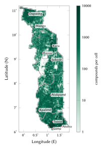
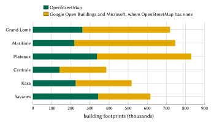
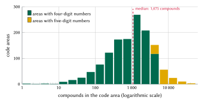
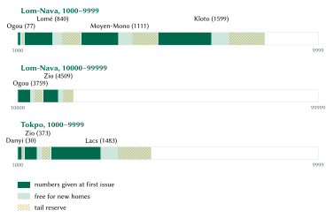
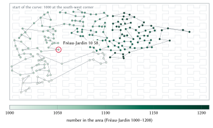
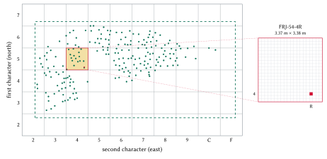
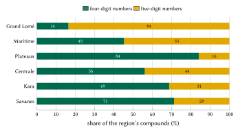

**Keywords:** addressing; postal codes; Togo; Hilbert curve; check digits; building footprints; spatial data infrastructure.

# Introduction

An address is a public good of a particular kind: it is worth little to the household that holds it and a great deal to everyone who has to find that household. Where addresses are missing, the cost is paid in small amounts by many people, in the courier's telephone calls, the ambulance's lost minutes and the utility's unpaid bill, and it is rarely measured. The World Bank's review of street addressing in African cities found that more than half of the streets in the region's cities had no name and that addressing programmes decay when residents do not use them [@farvacque2005]. The Universal Postal Union has argued that an address is part of a country's basic infrastructure, on the same footing as roads and electricity [@upu2012addressing].

Togo is a clear case. The country has no postal code [@upu2005togo; @usps2025togo]. Mail is delivered to post-office boxes. The former commune of Lomé has had coded streets since 1997, and the District Autonome du Grand Lomé (DAGL) is modernising them with entrance numbers that had not been published at the time of writing [@togopresse2025; @rot2026bonneadresse]. Elsewhere, and in most of Grand Lomé, a home is found by its quartier, a landmark and a telephone call.

This paper makes four contributions.

1. A **model** in which every compound of Togo receives a short code that people can say and remember: a place name and two pairs of digits. The code is unique in the whole country on its own, a property obtained by giving every place name one national range of numbers (Section 5).
2. A complete **mathematical specification**: area assignment, plate names, name folding, block allocation, Hilbert-curve numbering, insertion of new compounds, decoding, the check digit and a grid for points that are not compounds, each with a worked example on a real code (Section 5).
3. An open **implementation**: a reference engine with conformance vectors, the registry of all 2,768,053 codes, and a server that any public body can deploy to answer exactly as the issuer does (Section 6).
4. An **evaluation** of the measured properties of the issued codes (Section 7) and of the designs we rejected (Section 8), followed by an assessment of the benefits for citizens, logistics, emergency services and government, each with explicit assumptions (Sections 9 to 12).

Section 2 reviews Togo's existing addressing, postal and land systems and international practice; Section 3 describes the data; Section 4 states the design requirements. Sections 13 and 14 cover privacy, governance and limitations, and Section 15 concludes.

# Background and related work

## Togo: territory, population and administration

The fifth general census of population and housing (RGPH-5, November 2022) counted 8,095,498 inhabitants, of whom 42.9 % live in urban areas [@inseed2023rgph5; @koaci2023rgph5]. Grand Lomé had 2,188,376 inhabitants, 1,305,681 in the préfecture of Golfe and 882,695 in Agoè-Nyivé [@koaci2023rgph5]. The country is a strip about 600 km long from the Gulf of Guinea to the Sahel, with its towns strung along the national road: Lomé on the coast, then Tsévié, Atakpamé, Sokodé, Kara and Dapaong (Figure 1).

The country has five regions (Maritime, Plateaux, Centrale, Kara and Savanes) and the Autonomous District of Grand Lomé, 39 préfectures, 117 communes and about 394 cantons, the traditional chiefdoms that people know by name. French is the official language; Ewe in the south and Kabiyè in the north are national languages. Telephone numbers are given in French and in pairs ("quatre-vingt-dix, douze, trente-quatre, cinquante-six"), a habit the model relies on.

{#fig:density width=50%}

## Postal addressing

The UPU's addressing sheet for Togo gives a name, a box number and a town ("B.P. 526, LOME, TOGO") and no postcode field [@upu2005togo]. In Lomé a post-office prefix is placed before the box and after the town ("01 BP 2274 Lomé 01"). In June 2025 the Société des Postes du Togo (SPT) asked foreign senders to add the addressee's telephone number and e-mail address, not a postcode [@usps2025togo]. The SPT's PostMap application refers to "the postal code of an address" without a published format [@spt2024postmap]. A box identifies a counter, not a door, and the model keeps it as a free-text line.

## Lomé's street codes

The former commune of Lomé is divided into 69 quartiers, each with a code of two or three characters: AMT for Amoutivé, BE for Bè, HDN for Hédzranawoé, FRJ for Fréau-Jardin [@osmwikilome]. A street carries a number and its quartier's code, written "Rue Oukata-Waya 165 AMT", "Avenue de la Présidence 13.QAD" or "Rue Batemoni 46BE". Many streets also bear a name. Roughly a quarter of Lomé's streets are named in OpenStreetMap with their codes. A street code identifies a street, not a gate.

## The modernisation of Grand Lomé

On 17 December 2025 the DAGL and the firm Edenmap, within the Projet Environnement Urbain de Lomé funded by the Agence Française de Développement, presented the extended address databases of the 13 communes of Grand Lomé [@togopresse2025]. Streets are coded and then named; address points follow the metric system and are tied to an entrance number; signs bear the entrance number and the street's code or name [@rot2025modernisation]. About 500,000 addresses are to be created on 16,000 recorded streets, of which nearly 13,000 have no name [@rot2026bonneadresse]. A citizen module with Togo Digital is planned. No format, timetable or open dataset had been published by October 2026. The Council of Ministers adopted a proposed decree on the addressing of roads and public squares on 7 July 2022; addressing is a competence shared between the State and the local authorities [@gouv2022decret].

## Land registration

Land is registered by the Office Togolais des Recettes, and a registered property is designated by its *titre foncier*. The land code states that the cadastre "ne peut faire perdre ni conférer un droit de propriété" (art. 33) [@loi2018005]. An address and a land title answer different questions; the model never uses a land reference as an address and never implies a right to land.

## International practice

The UPU's S42 standard describes the components of a postal address and the templates in which each country arranges them [@upuS42]; it presupposes that the components exist. The World Bank's manual describes how a city names streets and numbers doors, typically by a metric rule along each street, at an average cost it estimated at US\$5.7 per doorway at 2005 prices [@farvacque2005]. Both approaches start from streets. In Togo most compounds do not face a named street, and the streets of Grand Lomé are being named by the DAGL; a national code cannot wait for that work, but it must make room for it.

## Grid codes and why they do not fit

A second family of systems encodes coordinates. Open Location Code (Plus Codes) encodes latitude and longitude in a base-20 alphabet; the compound beside Lomé's Grand Marché is 6FR346JF+P9 [@olc]. The SPT issued a call for interest for Plus Codes in 2020 and had earlier announced a three-word system [@togofirst2019w3w]; neither is in use. In Ghana, the National Digital Property Addressing System launched in 2017 gives each 5 m square a code made of a district prefix and digits [@citifm2017ghanapost]. A private Togolese application, TogoLink, issues GPS codes of five to seven characters under reserved rights.

Grid codes have real merits: they need no survey and they work offline. Their weakness, for our purpose, is that they encode a square, not a home. The code of a compound depends on where the reference point falls, two households of one compound share a cell, and the code carries no word that people already say. Letters spoken in French, Ewe and Kabiyè are a source of error: Q exists in neither national language and W and V are spelt out in French. We therefore keep a grid for points that are not compounds (Section 5.10) and give homes a code built from a name and digits.

## Official addresses first

One rule overrides every other choice: where the State gives an address, it is shown first, exactly as the State writes it. In the former commune of Lomé the official street within 30 m of the compound comes first on every card ("Rue Mission Tové, Lomé"); 71,002 compounds have one. When the DAGL's entrance addresses are shared or a resident confirms the plate on the gate, the DAGL address is attached to the compound and replaces the street; no N-Ways code changes. The N-Ways code stands beside the official address, so that it can be said on the telephone and can tell apart the households that share one gate. Everywhere else no official address exists at the level of the door, and the N-Ways code is the address.

# Data and sources

The model is computed from open data only (Table 1).

- **OpenStreetMap**: building footprints, walls, fences and hedges, gates, place names, the quartiers of Lomé with their official codes and Lomé's named streets, from the Geofabrik extract of 17 October 2026 [@geofabrik2026; @haklay2008osm].
- **Google Open Buildings and Microsoft building footprints**, through the Overture Maps buildings release, which keeps OpenStreetMap first and adds machine-detected footprints where OpenStreetMap has none [@overture2026buildings; @sirko2021openbuildings; @microsoft2023footprints].
- **Canton boundaries**: the 373 cantons of the HDX common operational dataset (COD-AB, valid on 7 January 2021, CC BY-IGO) [@hdx2021cod]. No open boundaries exist for the 117 communes.
- **Population**: the RGPH-5 totals [@inseed2023rgph5].

| Region | Compounds | Footprints | From OpenStreetMap | Median footprint |
|:--|--:|--:|--:|--:|
| Plateaux | 648,943 | 831,095 | 336,199 | 30.9 m² |
| Maritime | 590,823 | 746,954 | 216,701 | 40.4 m² |
| Grand Lomé | 545,465 | 719,517 | 259,523 | 51.6 m² |
| Savanes | 348,082 | 616,305 | 342,505 | 19.1 m² |
| Kara | 336,577 | 517,963 | 224,108 | 27.6 m² |
| Centrale | 298,163 | 384,919 | 139,729 | 31.3 m² |
| **Togo** | **2,768,053** | **3,816,753** | **1,518,765** | **39.4 m²** |

: Compounds and building footprints by region. {#tbl:regions}

Of the 3,816,753 footprints, 1,518,765 (39.8 %) come from OpenStreetMap and 2,297,988 from the machine-detected datasets (Figure 2). OpenStreetMap is strongest in Savanes, where it supplies 56 % of footprints, and weakest in Maritime and Grand Lomé. The height attribute of the machine-detected footprints takes only 36 distinct values between 3.5 and 7 m and is not used; OpenStreetMap gives floors for 398 buildings.

{#fig:sources width=88%}

# Design requirements

We fixed the requirements before the design and ranked them, so that every conflict between two of them has an answer.

1. **Easy to remember and to give.** A code is a place name people already say and two pairs of digits; obtaining it takes one action in the application.
2. **Unique nationally on its own.** No préfecture, commune or position of the telephone may be needed to decode it.
3. **The compound and its gate.** The unit is the plot or *cour*; buildings are sub-units; navigation ends at the gate.
4. **Official first**, wherever an official address exists (Section 2.8).
5. **Never mistaken for an official code.** A code starts with a name and has four or five digits, so it never looks like a Lomé street code ("165 AMT") or a box.
6. **Works offline.**
7. **Stable.** A code never moves and is never reused.
8. **Places, never people.**
9. **Open and transferable to the State.**

# The model

## The forms of a code

A code has several forms, each for a different reader (Table 2). For an area with plate name $P$ and key $K$, and a number $N$ of four or five digits,

$$
R = P \mathbin{\smile} \pi(N), \qquad M = \texttt{TG-}K\texttt{-}N\texttt{-}c,
\tag{1}
$$

where $R$ is the remembered form, $M$ the machine form, $c$ the check digit of Section 5.9, $\smile$ joins two strings with a space, and $\pi$ splits the digits into pairs from the right: $\pi(1058)$ is "10 58" and $\pi(14198)$ is "1 41 98".

| Form | Example | Used by |
|:--------------|:------------------------------|:------------------------------|
| Remembered | Fréau-Jardin 10 58 ("Fréau-Jardin, dix, cinquante-huit") | people: said, typed, written on a parcel |
| Machine | TG-FRJ-1058-2 | applications, QR codes, partner systems; the final digit is a check, for systems only |
| Structure, entrance | TG-FRJ-1058-2.2/1 | a building of the compound; one of its gates |
| Spot | FRJ-54-4R | any point: a stall, a field, a crash on the road |
| Official, in Lomé | Rue Mission Tové, Lomé | the State's address, shown first |

: The forms of one code. {#tbl:forms}

People never see, type or say the check digit. Plates and written forms show the name and the number only.

## Code areas

A **code area** is a place people name. There are three kinds (Table 3). The quartiers of Lomé are the official ones, with their official codes as keys [@osmwikilome]. Outside Lomé the canton is the unit: the 117 communes have no open boundaries, and the 39 préfectures are too large for short numbers (Zio alone has about 280,000 buildings). A canton too large for four-digit numbers is split into cells around the named places inside it.

| Kind | Count | Key | Example |
|:------------------------------|------:|:---------------------|:---------------------|
| Quartier of the former commune of Lomé | 69 | the official quartier code | FRJ Fréau-Jardin |
| Canton kept whole | 215 | préfecture (3 letters) and 2 digits | KOZ14 |
| Named-place cell of a split canton | 1,095 | canton key and 2 digits | KOZ0615 Zongo, in Kara |

: Kinds of code areas. {#tbl:areas}

A footprint $f$ at latitude $\varphi_f$ and longitude $\lambda_f$ belongs to the quartier that contains it, else to its canton; if the canton is split, to the cell $c$ whose named place is nearest. Distances use the local lengths of a degree of latitude and of longitude on the WGS 84 ellipsoid,

$$
m_\varphi = 111\,132.92 - 559.82\cos 2\varphi + 1.175\cos 4\varphi, \qquad
m_\lambda = 111\,412.84\cos\varphi - 93.5\cos 3\varphi
\tag{2}
$$

in metres per degree, and the cell is

$$
\operatorname{cell}(f) = \operatorname*{arg\,min}_{c}\; \sqrt{\big((\varphi_f-\varphi_c)\,m_\varphi\big)^2 + \big((\lambda_f-\lambda_c)\,m_\lambda\big)^2 }.
\tag{3}
$$

Of the 1,379 areas, 1,371 hold compounds. The median area holds 1,075 compounds and the largest, the canton of Sagbado in Golfe, 41,259 (Figure 3). Each area is frozen at first issue: its index, key, blocks of numbers and **frame**, the bounding box over which its numbers are laid out.

{#fig:sizes width=92%}

## Plate names

A name that does not fit on a plate or in one breath is not remembered; people shorten "Gboto Koissidamé" to "Koissidamé". Each area therefore has an official name and a **plate name**. Let $\mathrm{NFC}(s)$ be the string in Unicode normal form C, $\operatorname{words}(s)$ its words (a hyphen separates words) and $L = \{$de, du, des, d', la, le, les, l', et, sur, en, au, aux, à$\}$ the set of words that do not count. Then

$$
\operatorname{plate}(s) \iff |\mathrm{NFC}(s)| \le 12 \;\wedge\; |\operatorname{words}(s) \setminus L| \le 2 \;\wedge\; s \text{ contains no digit}.
\tag{4}
$$

A name that fails Eq. (4) goes through fixed steps, and the first that succeeds is kept. The name is first cleaned: text in brackets or after a slash and generic words such as Zone, Quartier, Village, Résidence or Cité are removed ("Zone Portuaire" becomes *Portuaire*, "Dako/Daoude" becomes *Dako*). Otherwise the most distinctive run of whole words is taken when it is clearly ahead, preferring the end of the name, where the specific part usually stands ("Adjahun Fiagbe" becomes *Fiagbe*). A word is never cut. Some words are never dropped automatically: in Ewe and Mina, *kopé*, *kondji* and *kodzi* mean village and *kpota* the outskirts, so "Aklassou kopé" is a village of its own. A plate name may not equal a préfecture seat, a quartier of Lomé or a well-known town across the border, unless it is the area's own.

| Plate names | Areas |
|:--|--:|
| Official name kept as it is | 1,253 |
| Cleaned | 17 |
| Shortened to its distinctive words | 33 |
| Provisional, offered to the commune | 76 |
| **Total** | **1,379** |

: How the plate names were obtained. {#tbl:plates}

Of the 1,379 official names, 122 exceed the limit. Seventy-six areas carry a provisional plate name, the first of up to three candidates, which their commune may replace once: 38 join two names with a hyphen, 25 are single words longer than 12 letters, 9 would drop a qualifier such as *kopé* or *haut*, 2 would equal a known town and 2 offer no clear choice. Their 145,645 codes are issued; a later choice changes the name, never the number. A hyphenated name offers its rarer part first: "Agoè-Démakpoè" offers *Démakpoè*, because "Agoè" begins four area names. The official name remains an alias (95 aliases in all), so typing the full name finds the same compound.

## The name key

Two spellings of one name must decode alike. The **name key** is the composition

$$
\operatorname{key}(s) = \operatorname{fold}\circ\operatorname{drop\_parts}\circ\operatorname{drop\_article}\circ\operatorname{upper}\circ\operatorname{unaccent}\circ\operatorname{ewe}(s),
\tag{5}
$$

whose steps are listed in Table 5.

| Step | Rule | Example |
|:-------------------|:--------------------------------|:----------------------|
| ewe | ɛ ɔ ŋ ƒ ʋ ɖ ɣ become e o n f v d g | Kpɔta → Kpota |
| unaccent, upper | accents and case removed; any character other than a letter or digit becomes a space | Agoè-Nyivé → AGOE NYIVE |
| drop\_article, drop\_parts | a leading le, la, les or l' and trailing part numbers (1, 2, I–IV) removed | Zongo 1 → ZONGO |
| fold | spaces removed; PH → F, QU → K, DJ → J, OU → U, W → U; C before A, O, U or at the end → K; doubled letters single | Djanta Copé, Djanta kopé → JANTAKOPE |

: The steps of the name key, Eq. (5). {#tbl:key}

Folding can only merge names, never split one, so an error in folding costs at most a shared range, never a lost code. The 1,379 areas carry 1,323 name keys; 50 keys are shared by 106 areas holding 240,136 compounds. Lom-Nava occurs in six places; Kamina and Tokpo in three; Zongo, Amoutivé, Akodésséwa and Sanguéra in two.

## One national range per name

Every name key owns the numbers 1000–9999 and 10000–99999 nationally. An area with $c$ compounds receives a block of

$$
b(c) = \max\!\left(200,\; 100\left\lceil \frac{2c}{100}\right\rceil\right)
\tag{6}
$$

numbers: twice its compounds, in whole hundreds, at least 200. The areas of a name are placed in increasing order of block size, then of area index. With $u$ the highest number already used in the relevant part of the name's range, a block is placed at

$$
[\,lo, hi\,] =
\begin{cases}
[\,u_4+1,\; u_4+b\,] & \text{if } u_4 + b \le 9999,\\[2pt]
[\,u_5+1,\; u_5+b\,] & \text{else, if } 99999 - (u_5+b) \ge 5000,\\[2pt]
\text{a qualifier is required} & \text{otherwise,}
\end{cases}
\tag{7}
$$

where $u_4$ starts at 999 and $u_5$ at 9999. A four-digit block and a five-digit block are never mixed, and each name keeps at least 5,000 numbers free for future areas of the same name. No name needed a qualifier.

*Worked example: Fréau-Jardin.* One area, 209 compounds: $b(209) = \max(200, 100\lceil 4.18\rceil) = 500$, so the block is 1000–1499.

*Worked example: Tokpo*, three areas up to 140 km apart (Figure 4). Danyi, 30 compounds: $b = 200$, block 1000–1199. Zio, 373 compounds: $b = 800$, block 1200–1999. Lacs, 1,483 compounds: $b = 3000$, block 2000–4999. "Tokpo 11 00" is in Danyi and "Tokpo 24 17" in Lacs; "Tokpo 54 17" lies in no block and is refused.

*Worked example: Lom-Nava*, the most repeated name. Four blocks fit in the four-digit part: Ogou (77 compounds, 1000–1199), the quartier of Lomé (840, 1200–2899), Moyen-Mono (1,111, 2900–5199) and Kloto (1,599, 5200–8399). The fifth, the canton in Ogou with 3,759 compounds, needs 7,600 numbers, which no longer fit below 9999; it opens the five-digit part at 10000–17599, followed by Zio (4,509, 17600–26699).

{#fig:blocks width=100%}

At first issue 1,251 areas have four-digit numbers and 128 have five. By compound, 1,549,299 (56.0 %) have four digits and 1,218,754 (44.0 %) five. Five digits are concentrated in Grand Lomé's large cantons (Sagbado, Legbassito, Togblékopé, Klémé) and in inland towns mapped as a single place point (Sokodé, Tsévié, Dapaong); Figure 7 gives the shares by region. A new area of an existing name, or an area whose block is full, takes the next block above every block of its name; blocks never move, shrink or get renumbered.

## Numbering inside an area: the Hilbert curve

Inside an area, compounds are numbered along a Hilbert curve [@hilbert1891] of order 16 laid over the area's frozen frame $(x_0, y_0, x_1, y_1)$, at each compound's reference point: the centre of its main building until a gate is confirmed. The Hilbert curve preserves locality better than row-by-row or Z-order scans [@moon2001hilbert], so neighbouring compounds receive neighbouring numbers and a courier who knows one number knows roughly where the next lies. The point $(\varphi, \lambda)$ maps to integer grid coordinates

$$
g_x = \left\lfloor \frac{\lambda - x_0}{x_1 - x_0}\,(2^{16}-1) \right\rfloor, \qquad
g_y = \left\lfloor \frac{\varphi - y_0}{y_1 - y_0}\,(2^{16}-1) \right\rfloor .
\tag{8}
$$

The Hilbert index $h$ is accumulated over the scales $s = 2^{15}, 2^{14}, \dots, 1$. With $r_x = [\,g_x \wedge s \ne 0\,]$ and $r_y = [\,g_y \wedge s \ne 0\,]$ at each scale,

$$
h = \sum_{s} s^2 \big( (3 r_x) \oplus r_y \big),
\tag{9}
$$

where, after each term, the quadrant is rotated: if $r_y = 0$, then $(g_x, g_y) \leftarrow (2^{16}-1-g_x,\, 2^{16}-1-g_y)$ when $r_x = 1$, followed by $(g_x, g_y) \leftarrow (g_y, g_x)$. The $n$ compounds of an area with block $[lo, hi]$ and capacity $C = hi - lo + 1$ are sorted by $(h, \text{stable identifier})$ and receive

$$
N_i = lo + i\,\sigma, \qquad \sigma = \max\!\left(1, \left\lfloor \frac{C}{1.5\,n} \right\rfloor\right), \qquad i = 0, \dots, n-1,
\tag{10}
$$

so that $\sigma - 1$ free numbers follow each compound. The top third of the block is held back as a **tail reserve**, starting at

$$
t = lo + \left\lfloor \tfrac{2}{3}\, C \right\rfloor .
\tag{11}
$$

*Worked example: Fréau-Jardin 10 58.* The compound's reference point is $\varphi = 6.1317765$, $\lambda = 1.2234008$, and Fréau-Jardin's frame is $(1.22204, 6.13038, 1.22759, 6.13306)$. Eq. (8) gives

$$
g_x = \left\lfloor \frac{0.0013608}{0.00555} \cdot 65\,535 \right\rfloor = 16\,068, \qquad
g_y = \left\lfloor \frac{0.0013965}{0.00268} \cdot 65\,535 \right\rfloor = 34\,149,
$$

and Eq. (9) gives $h = 1\,164\,396\,171$, the 59th of the area's 209 compounds along the curve ($i = 58$). With $C = 500$, Eq. (10) gives $\sigma = \max(1, \lfloor 500/313.5 \rfloor) = 1$ and $N = 1000 + 58 = 1058$; Eq. (11) puts the tail reserve at 1333–1499. Figure 5 shows the whole area.

{#fig:hilbert width=100%}

## New compounds

A compound built after first issue lies on the curve between two issued neighbours with numbers $a$ (at or before its position) and $b$ (after it). With $U$ the set of numbers ever issued in the area, retired ones included, it takes

$$
N^\ast = \operatorname*{arg\,min}_{\,n \in (a,\, b)\,\setminus\, U} \left| n - \frac{a+b}{2} \right|,
\tag{12}
$$

the lowest on ties, among numbers below the tail reserve. If no such number exists it takes the lowest free number of the tail reserve, then of the area's later blocks; a full area takes a new block of its name by Eq. (6) and Eq. (7). In Fréau-Jardin $\sigma = 1$, so a house built between two neighbours receives Fréau-Jardin 13 33, the first number of the tail reserve. Where $\sigma$ is larger, new homes take numbers between their neighbours. A new compound joins the area of the nearest issued code within 250 m, then the area containing its point, then the nearest area, so that it shares its neighbours' name.

## Decoding without context

A text is read as a name followed by a number of four or five digits, in pairs or not, separated by spaces or dots. With $A(P)$ the set of areas whose plate name or alias has the key of $P$,

$$
\operatorname{decode}(P, N) = \{\, a \in A(P) : N \in \operatorname{blocks}(a) \,\}.
\tag{13}
$$

Because the blocks of a name are disjoint, Eq. (13) has at most one element. A number in no block is reported as not issued, never guessed into a nearby place. A check digit, if a system sends one, must verify. A Lomé street code (one to three digits followed by a quartier code, as in "165 AMT", "46BE" or "13.QAD") is recognised and answered as a street, never read as an N-Ways code.

## The check digit

The machine form carries a check digit computed with Damm's algorithm [@damm2004], which uses a totally anti-symmetric quasigroup of order 10. Unlike the Luhn digit, it detects every single-digit error and every transposition of adjacent digits; Verhoeff's earlier dihedral scheme has the same power with more complex tables [@verhoeff1969]. Let $d_1 d_2 \dots d_k$ be the digits of the name's national identifier (four digits), the area's index (four digits) and the number. Then

$$
c_0 = 0, \qquad c_j = T[c_{j-1}][d_j], \qquad c = c_k,
\tag{14}
$$

with Damm's table

$$
T = \begin{pmatrix}
0&3&1&7&5&9&8&6&4&2\\
7&0&9&2&1&5&4&8&6&3\\
4&2&0&6&8&7&1&3&5&9\\
1&7&5&0&9&8&3&4&2&6\\
6&1&2&3&0&4&5&9&7&8\\
3&6&7&4&2&0&9&5&8&1\\
5&8&6&9&7&2&0&1&3&4\\
8&9&4&5&3&6&2&0&1&7\\
9&4&3&8&6&1&7&2&0&5\\
2&5&8&1&4&3&6&7&9&0
\end{pmatrix}.
$$

*Worked example.* Fréau-Jardin's name identifier is 1352 and its area index 32, so the digit string is 1352 0032 1058. Eq. (14) passes through the states 3, 0, 9, 8, 9, 2, 6, 6, 8, 9, 3, 2, and the check digit is 2: the machine form is TG-FRJ-1058-2. Swapping the last two digits (1085) gives 3 and changing the last (1059) gives 6, so both slips are refused. Because the name and the area enter the check, a number copied onto another area, even one with the same name, also fails.

## Spot codes

Every point of Togo also has a **spot code**, computed offline on a geographic grid of $\delta = 1/32\,768$ degree (about 3.4 m), framed on its quartier or canton. The grid is geographic rather than projected because Togo straddles UTM zones 30 and 31 at the zero meridian. The alphabet is `23456789CFGHJKMPRVWX`: it has no vowels, so no word can form in French, Ewe or Kabiyè; no 0, O, 1, I or L; and K instead of Q, since K exists in both national languages. For a frame with box $(e_w, e_s, e_e, e_n)$,

$$
x_0 = \frac{\lfloor 1024\, e_w \rfloor}{1024}, \quad
n_x = \left\lceil \log_{20}\!\left( \frac{e_e - x_0}{\delta} + 1 \right) \right\rceil, \quad
i_x = \left\lfloor \frac{\lambda - x_0}{\delta} \right\rfloor,
\tag{15}
$$

and likewise $y_0$, $n_y$ and $i_y$ from $e_s$, $e_n$ and $\varphi$. The code is the frame key followed by the base-20 digits of $i_y$ and $i_x$, interleaved from the north, split into two halves.

*Worked example.* For Fréau-Jardin 10 58, $x_0 = 1251/1024 = 1.2216797$ and $y_0 = 6277/1024 = 6.1298828$; $n_x = \lceil \log_{20} 194.7 \rceil = 2$ and $n_y = \lceil \log_{20} 105.1 \rceil = 2$. Then $i_x = 56 = 2 \cdot 20 + 16$, which gives the characters 4 and R, and $i_y = 62 = 3 \cdot 20 + 2$, which gives 5 and 4. Interleaved $(y, x, y, x)$ the code is FRJ-54-4R, a cell of 3.37 m by 3.38 m (Figure 6). A quartier of Lomé gives four characters; a canton gives six or seven. A point between two quartier polygons uses its canton's frame, so that every code decodes back to its own cell. A point in no outline at all, in a thin gap between two outlines or just over a border line, takes the frame of the nearest outline within 1,100 m whose frame holds it, the distance being measured to the outline's edges with longitude scaled by $\cos\varphi$ and ties going to the lower key. If none of those frames holds it, the nearest outline whose frame lies at most 200 cells (about 675 m) away gives the point that frame's nearest edge cell, and the registry keeps the exact entrance. Frames never move, and a code decodes in the frame it names. The 4,415 compounds whose entrance lies in no outline are at most 1,081 m from one; each takes its nearest outline's frame, 13 of them on an edge cell at most 177 cells beyond it, so every compound has a spot code. A spot code is shared by link; it is never needed to find a home.

{#fig:spot width=100%}

## Compounds

The registry groups footprints into compounds before any number is given, one area at a time, after putting them in a fixed order by their stable identifier (Table 6). The distance between two footprints is the shortest distance between their outlines, zero when they touch or overlap.

| Rule | Condition | Effect |
|:------------|:--------------------------------|:--------------------------------|
| Enclosure | the footprint's centre lies inside a mapped closed wall, fence or hedge of at most 6,000 m² | the enclosure is one compound |
| Annex | a footprint under 30 m² (kitchen, shower, guard's lodge) | joins the nearest footprint of at least 30 m² within 6 m (8 m in Kara and Savanes) |
| Hut cluster | Kara and Savanes only: huts under 35 m² that belong to no house, at most 3 m apart | one compound of at most 20 huts |
| Single | any other footprint | its own compound |

: Rules for grouping footprints into compounds. {#tbl:group}

Only annexes join a house, and a hut cluster never joins two houses, so groups cannot chain. The rules produce 2,768,053 compounds from 3,816,753 footprints, 1.38 footprints per compound: 2,063,440 single footprints, 649,100 houses with their annexes, 54,003 hut clusters and 1,510 mapped enclosures. By size, 2,063,915 compounds have one structure, 492,792 two, 138,808 three and 72,538 four or more. With the 2022 census population, a compound holds on average 2.9 people.

## The building profile

Every structure carries a use class with its confidence and source, its size, its floors where known and a status. The classes for Togo are residential (family compound, *cour commune*, villa, rows of *chambres-salon*, *immeuble*, round hut, *takienta*), commercial, office, government, education, health, religious, industrial, hospitality, transport, agricultural, annex, under construction and ruin. Classes are inferred in a fixed order of evidence: the OpenStreetMap building type (confidence 0.85), a shop, amenity or office tag (0.75), a mapped place inside the footprint (0.65), the footprint's size (0.3 to 0.4), and otherwise residential by default (0.45). The evidence is thin: 3,752,065 structures are residential, almost all by default, against 46,322 annexes, 9,651 commercial buildings, 1,688 schools, 1,215 religious buildings and 901 health facilities. A home never carries a name.

# Implementation

**Reference engine.** The engine (`engine/reference/tg_engine.py`, with `plate_names.py`) implements every rule of Section 5 in the Python standard library: parsing, the name key, decoding, the check digit, Hilbert numbering and insertion, extension blocks, spot codes and compound grouping. The normative specification is `engine/SPEC.md`. Any other implementation is conformant if it reproduces the published vectors: `test_vectors.json` and `vectors.json`, which cover names, forms, 2,218 decodings, spot codes, numbering and insertion, Hilbert indices and pairs. The engine's tests check all of them.

**Registry.** The registry (`registry/`) publishes every code: one gzip-compressed CSV file per préfecture, 40 in all, the frozen area table and a manifest with the count and SHA-256 digest of every file. Each row gives the machine, remembered and written forms, the zone, the number and check, the status (provisional or confirmed), the entrance point, the spot code, the official address where one exists and the building profile.

**Server.** The `server/` directory contains a deployable HTTP service, also limited to the standard library. One command imports the registry into SQLite, verifying every digest and count; the service then answers a JSON API: the card of a code, search by any form, the code at a point, codes near a point, verification, spot codes, zones and areas. A deployment can export the registry back in the published format, and the export is byte-identical to the files it imported. Issuing is disabled unless keys are configured; when enabled, the server issues new codes by the rules of Section 5.7. We checked parity with the issuer on a fixture: for 20 sequential points and an area filled to its last number, the server reproduces the issuer's numbers, forms and spot codes exactly. On the full registry, 50 randomly drawn codes agreed with the issuer's own API on all 21 compared fields.

**Issuer.** Codes were issued once, on 20 October 2026, with every number checked against the reference engine before it was written. The register of areas is frozen: later runs add codes for new compounds and never renumber an issued one.

# Evaluation

We report the properties of the 2,768,053 issued codes, measured on the published registry with the reference engine.

**Uniqueness and decoding.** Every written form and every machine form decodes, by Eq. (13), to its own area and number: 0 failures in 2,768,053 of each. No two areas of one name share a number, which the engine verifies when it loads the register.

**Digits.** 56.0 % of compounds have four-digit numbers and 44.0 % five; no compound needs more than five digits and no name needs a qualifier. The share of four-digit numbers ranges from 16 % in Grand Lomé to 84 % in Plateaux (Figure 7).

{#fig:digits width=88%}

**Length.** The written form ("Fréau-Jardin 10 58") has a mean of 14.5 characters and a median of 14; the longest has 22, a single long word whose commune has not yet chosen a shorter name. Of the 1,379 plate names, 1,354 satisfy Eq. (4); the 25 that do not are single words longer than 12 letters awaiting their commune's choice.

**Coverage.** Every compound in the map data has a code: 100 % of the 2,768,053 compounds, against 2.6 % (71,002) that lie within 30 m of a named street of Lomé.

**Error detection.** We drew 200,000 codes at random and applied every single-digit substitution and every transposition of adjacent unequal digits to their numbers (Table 7). Variants that begin with a zero are not valid numbers and are refused by syntax alone; of the remaining variants, the check digit of the machine form detected all 7,790,038 substitutions and all 585,755 transpositions, as Damm's construction guarantees. The remembered form carries no check: 75.7 % of single-digit substitutions and 71.0 % of adjacent transpositions still produce a number issued under the same name, because blocks are dense by design. A remembered code read with a slip therefore usually designates another real compound, often nearby, and the application must show the place on a map and read the code back before a journey starts. This is the price of a code without a visible check digit, and Section 8 explains why we accept it.

| Slip in the number | Variants | Issued under the same name | Refused | Leading zero |
|:--|--:|--:|--:|--:|
| One digit changed | 7,990,038 | 75.7 % | 21.8 % | 2.5 % |
| Two adjacent digits swapped | 613,672 | 71.0 % | 24.5 % | 4.5 % |
| *Machine form, either slip* | 8,375,793 | *0 %, all detected* | | |

: Effect of a slip on 200,000 randomly drawn codes. The machine-form row counts the variants without a leading zero. {#tbl:slips}

**Grouping.** We tested the compound rules by hiding the 966 mapped walls, fences and hedges that enclose two or more buildings and re-running the rules without them. Only 9.0 % of these enclosures come out whole and 7.2 % exactly, while a further 38.5 % miss a single building. Behind a Togolese wall the main house, the rented rooms and the kitchen are often separate buildings, and without a mapped wall the rules keep them apart on purpose: merging two codes later costs nothing, whereas splitting a wrong merge would give a household a new code.

**Worked examples.** Table 8 lists, for well-known places, the compound nearest each.

| Near | Code | Machine form | Spot code | Shown first |
|:-----------------|:-------------------|:----------------------|:-----------------|:-----------------|
| Grand Marché, Lomé | Fréau-Jardin 10 58 | TG-FRJ-1058-2 | FRJ-54-4R | Rue Mission Tové, Lomé |
| Bè, Lomé | Souza-Nétimé 29 22 | TG-SZN-2922-8 | SZN-22J-M95 | Rue de Tone, Lomé |
| Université de Lomé | Université 12 69 | TG-UB-1269-1 | UB-22P-F5F | |
| Agoè-Nyivé | Agoè-Nyivé 1 33 31 | TG-AGN0204-13331-0 | AGN02-46K-MFG | |
| Kara | Zongo 1 41 98 | TG-KOZ0615-14198-6 | KOZ06-454-R32 | |
| Sokodé | Sokodé 1 41 08 | TG-TCH0603-14108-0 | TCH06-56G-58X | |
| Atakpamé | Gnagna 11 02 | TG-OGO0711-1102-5 | OGO07-22M-R23 | |
| Kpalimé | Fiakomé 20 28 | TG-KLO0403-2028-4 | KLO04-49G-JJ5 | |
| Tsévié | Tsévié 1 91 72 | TG-ZIO1502-19172-2 | ZIO15-46K-468 | |
| Aného | Aného 1 24 64 | TG-LAC0402-12464-5 | LAC04-322-H6C | |
| Dapaong | Dapaong 2 06 41 | TG-TON0204-20641-9 | TON02-953-WXC | |
| Bassar | Bassar 1 79 00 | TG-BAS0303-17900-5 | BAS03-322J-7739 | |

: Issued codes nearest well-known places. {#tbl:examples}

The same name in two places causes no ambiguity: `zongo 1500` lies in the Zongo of Kloto, whose block is 1000–2699, and `zongo 14198` in that of Kara, 10000–23299. A partner system that receives TG-FRJ-1085-2, with two digits swapped, refuses it, because the check of 1085 is 3.

# Designs considered and rejected

We compared the candidate forms on the five properties that matter on the telephone and on a parcel (Table 9).

| Form | Example | Said on the telephone | Remembered | Unique alone | Survives a reform |
|:--------------------|:----------------|:-----------------|:--------------|:------------|:------------|
| Préfecture and alphanumerics | ZIO 7HK2X | hard: letters read differently in French, Ewe, Kabiyè | hard | yes | no |
| National digits | 4817229 | easy | hard: no anchor | yes | yes |
| Plus Code | 6FR346JF+P9 | hard: letters and a sign | hard | yes | yes |
| Lomé street code | 165 AMT | easy | medium | the street, not the gate | yes |
| Name and number, préfecture to separate repeats | Tokpo 24 17, Lacs | easy | medium | only with the préfecture | no |
| **Name and number, one national range per name** | **Fréau-Jardin 10 58** | **easy, in pairs** | **easy** | **yes** | **yes** |

: Candidate forms of the code. {#tbl:options}

*Préfecture and alphanumerics.* Zio alone has about 280,000 buildings; numbered by préfecture, it would need five base-20 characters or six digits, and the letters are read differently in the three languages.

*National digits.* Seven digits with no anchor are hard to remember, and a slip lands anywhere in the country.

*A qualifier for repeated names.* Separating the three Tokpos by their préfecture makes the code depend on a second word that people omit when they give their address and that changes when boundaries are reformed. Sharing one national range costs some areas a fifth digit; we measured the cost at 44.0 % of compounds, most of them in large cantons of Grand Lomé whose quartiers are not yet named in open data.

*Full official names.* "Centre de formation rurale de Tami 10 17" is too long to say with a number; Eq. (4) shortens it to Tami.

*No N-Ways code where an official address exists.* Giving Grand Lomé only the official address would have left most of its compounds without any address today, since the DAGL's entrance addresses are not yet published and many households share one gate. We chose one code for every home with the official address shown first.

*A visible check digit.* A check character that people say would detect slips in the remembered form (Table 7), but it lengthens every code, it is the part people forget first, and it cannot be verified by a listener. We keep it in the machine form, where systems verify it, and rely on the map and read-back for people.

*Why Damm's algorithm.* Detecting every single error and every adjacent swap with one decimal digit requires a quasigroup such as Damm's or a dihedral scheme such as Verhoeff's; the modulus-11 alternative needs an eleventh symbol. Damm's needs one table and no permutation, and including the name and area in the check catches a number copied onto the wrong area of the same name.

*Heights from machine-detected footprints.* Their height attribute is a placeholder (Section 3), so floors come only from OpenStreetMap.

# Benefits for citizens

For a family in a *cour commune* of Bè, in a village of Plateaux or in a new house in Agoè, a code changes four ordinary things.

**Being found.** Today a visitor, a motorcycle taxi or a delivery rider is guided by telephone, landmark by landmark. With a code, the household says one short phrase, "Zongo, un, quarante et un, quatre-vingt-dix-huit", and the application leads to the gate.

**Proving where one lives.** Banks, mobile-money agents, schools and employers ask for an address, and almost nobody can give one that anyone can check. Before the codes were issued, 71,002 compounds (2.6 %) lay within 30 m of a named street of Lomé; all 2,768,053 now have a code.

**Receiving goods and services.** Relatives abroad, shops and water and electricity services can send to a code instead of a description, and a household can ask for a connection or a repair at the right gate.

**No cost to the household.** Every compound already mapped had its code from the day of issue; it is free, needs no document and holds no personal data. It is not a land title.

**Who benefits most.** Those with least today: villages far from the national road, the hut compounds of the north, tenants who share a gate, and people who do not read French well, for whom a known place and two pairs of digits are easier than a street name. We did not find a published estimate of the time Togolese households spend guiding visitors; Section 14 proposes a measurement.

# Logistics and commerce

Delivery in Togo runs on the telephone and the motorcycle taxi. In Africa a single last-mile delivery attempt costs on average about US\$2.70, and first-attempt success can be as low as 60 % [@nextbillion2023]; a logistics software vendor uses a failed-delivery rate of 5 % in its cost benchmarks for the Middle East and Africa [@locus2026]. Let $f_0$ be the rate of failed first attempts without a code, $f_1$ the rate with a code, $\alpha$ the share of the difference due to locating the customer, and $k$ the cost of an attempt. The saving per 1,000 deliveries is

$$
S = 1000\,\alpha\,(f_0 - f_1)\,k .
\tag{16}
$$

We take $k = 2.70$ and $f_1 = 0.05$ from the sources above and treat $f_0$ and $\alpha$ as uncertain (Table 10). The central case, $f_0 = 0.20$ and $\alpha = 0.5$, gives US\$203 per 1,000 deliveries; the range is US\$34 to US\$945. These are not measurements in Togo, and Section 14 proposes how to make them.

| | $f_0 = 0.10$ | $f_0 = 0.20$ | $f_0 = 0.40$ |
|:--|--:|--:|--:|
| $\alpha = 0.25$ | 34 | 101 | 236 |
| $\alpha = 0.5$ | 68 | 203 | 473 |
| $\alpha = 1$ | 135 | 405 | 945 |

: Saving per 1,000 deliveries, Eq. (16), in US dollars, with $k = 2.70$ and $f_1 = 0.05$. {#tbl:delivery}

For a logistics business the code is also a stable customer key, it resolves to the gate (or the main building until the gate is confirmed), and the machine form's check digit catches a mistyped code at once. The registry and the engine are open, so any firm can resolve codes in its own systems, offline. The port of Lomé serves the whole corridor to the north: importers, transit agents and the traders of the Grand Marché and Hédzranawoé can send goods and payments to a compound by code, and a cooperative in Plateaux can list its members by code rather than by village. The SPT's carriers and its PostMap application can deliver to a gate instead of a box.

# Emergency services

An ambulance, a fire crew or a police patrol faces the courier's problem with more at stake. A qualitative study of emergency medical services in Kigali found that crews and dispatchers lost time locating patients because they relied on local knowledge and needed several calls to pass on the location [@hunt2023ems]. Togo's emergency numbers are 117 and 161 for the police, 172 for the gendarmerie and 118 for the fire service [@mfa2026togo]. We found no published measurement of locating times in Togo.

A code helps a dispatcher in four steps. The caller says one phrase ("Tokpo, vingt-quatre, dix-sept"), and the registry returns one compound, in Lacs, not one of the two other Tokpos. The dispatcher reads it back while the map shows the place, its préfecture and the gate, which also guards against the slips of Table 7. The crew drives to the gate, and a spot code marks any point without a compound, such as a crash on the N1. All of this works offline.

For out-of-hospital cardiac arrest, Larsen and colleagues modelled survival as 67 % less 2.3 percentage points per minute before cardiopulmonary resuscitation, 1.1 per minute before defibrillation and 2.1 per minute before advanced care [@larsen1993]; we write these per-minute decrements as $\beta_{\mathrm{CPR}} = 2.3$, $\beta_{\mathrm{D}} = 1.1$ and $\beta_{\mathrm{ACLS}} = 2.1$. If a single crew brings all three and the code saves $\Delta t$ minutes in finding the gate, the gain is

$$
\Delta P = (\beta_{\mathrm{CPR}} + \beta_{\mathrm{D}} + \beta_{\mathrm{ACLS}})\,\Delta t = 5.5\,\Delta t
\tag{17}
$$

percentage points; if only defibrillation is delayed, it is $\beta_{\mathrm{D}}\,\Delta t = 1.1\,\Delta t$. For $\Delta t$ between 1 and 5 minutes the gain lies between 1.1 and 27.5 points. The model was estimated in King County, Washington, where bystander resuscitation is common, so these figures indicate an order of magnitude for Togo, not a prediction.

# Government coordination and planning

A code is a shared key. When ministries, communes, utilities and INSEED refer to a compound by the same code, their records can be joined without matching names and descriptions.

**One reference for all services.** An address register gives a list of premises more complete than a tax roll and shows who is missing from it [@farvacque2005]. In Grand Lomé, the N-Ways registry and the DAGL's addresses can be compared gate by gate once they are shared, and every DAGL address attached to a compound makes both more complete.

**A code that outlives reforms.** Communes and préfectures are attributes looked up from a compound's position. When a commune is created or its boundary moves, every code keeps working and shows its new commune; the area in the machine form never moves.

**The census.** A table of codes against the census enumeration areas would give the next census a frame of 2,768,053 compounds to sample from and return to, and give the registry household counts, without storing any name.

**Planning with real counts.** The registry counts compounds by region, préfecture, area, grouping rule and building class, and every count can be recomputed from the open files. Table 11 gives an example: straight-line distances from a random sample of 20,000 compounds to the nearest mapped facility. These figures describe the map as much as the country, because village health posts and gendarmeries are thinly mapped; a ministry can replace the facility list with its own and recompute them in minutes.

| Facility | Mapped facilities | Within 2 km | Within 5 km | Median distance |
|:--|--:|--:|--:|--:|
| Health facility | 789 | 51.3 % | 74.4 % | 1.9 km |
| School | 2,873 | 67.8 % | 85.9 % | 0.9 km |
| Police | 130 | 25.5 % | 44.7 % | 6.6 km |
| Pharmacy | 310 | 32.4 % | 46.8 % | 6.1 km |

: Straight-line distance from 20,000 random compounds to the nearest mapped facility. {#tbl:access}

**What a door-numbering survey would have cost.** At the World Bank's average of US\$5.7 per doorway at 2005 prices [@farvacque2005], numbering $n$ compounds on the ground at a unit cost $c_d$ would cost

$$
C = n\,c_d = 2\,768\,053 \times 5.7 \approx 15.8 \text{ million US dollars},
\tag{18}
$$

or 7.9 to 23.7 million if the unit cost is taken to vary by half either way. This is a reference figure, not a saving: plates, signs and the confirmation of gates still have a cost, and the codes complement rather than replace the DAGL's street addressing.

# Privacy, safety and governance

**Places, not people.** Codes describe places. Homes carry no names and no occupant data; business and public buildings carry their public names. The registry publishes every compound's code, entrance point and building profile and nothing about the people who live there. No identity number is collected and nothing links a code to the national identification number. Law no. 2019-014 on the protection of personal data applies, with the IPDCP, in operation since March 2025, as the authority [@ciomag2025ipdcp]; the prior declaration the law requires covers the personal data the application processes (telephone numbers and photographs). What the application holds about people is disclosed only on a court order, and such disclosures are reported publicly.

**Not a title, not a list.** An address is neither a land title nor an eviction list. The application states that a code is an address, not a title, and the land code itself denies the cadastre any power to confer property [@loi2018005].

**Confirmation.** Every code starts as provisional. It becomes confirmed when at least two independent signals agree and none disagrees: journeys or deliveries that end at the gate, the household confirming on two different days, a partner's record, or new imagery showing the buildings. A neighbour's objection keeps the code provisional until the signals settle it. No code waits in a queue for manual review, and no confirmation changes a number.

**Governance.** N-WAYS LIMITED maintains the model and is the single issuer. Areas, blocks and frames are frozen and codes never move; regrouping never changes an issued code. A commune may rename an area (the old name remains an alias), choose a provisional plate name once, or add areas. The DAGL's addresses and Lomé's street codes belong to the State: they are shown as written, never edited, and mismatches seen on the ground are reported to the DAGL. A deployment of the server issues codes only if the State or N-WAYS LIMITED has designated it, because two issuers would give the same number twice. The repository, the registry and the rules can be transferred to the State or a body it designates under their open licences, without forking the engine.

# Limitations and future work

- **The areas depend on open data.** OpenStreetMap place points are uneven; names and spellings need confirmation by residents and communes, and towns mapped as a single point, such as Sokodé and Tsévié, form large areas with five-digit numbers. INSEED's locality lists would allow later areas to be cut smaller without changing any issued code.
- **Seventy-six plate names are provisional**, 25 of them still over the limit, until the communes choose.
- **Compounds are inferred.** Few walls are mapped; most compounds are a single building or a house and its annexes (Section 7).
- **Uses are mostly a default**, and floors are almost always unknown.
- **Gates are not yet known.** All 2,768,053 entrance points are the centre of the main building; gates will be confirmed by residents and couriers.
- **The remembered form has no check.** Three slips in four produce another issued number of the same name (Table 7); read-back and the map are the safeguard.
- **The DAGL's data are not open.** Until they are shared, Lomé shows its street, and the DAGL address only where residents confirm it.
- **The canton boundaries** of the HDX dataset are not an official gazette; they are frozen for stability, not for authority. Thinned, they leave thin gaps and stop at the border line: 4,415 compounds stand outside every outline. They keep their area, and their spot code comes from the nearest outline's frame (Section 5.10).
- **The impact estimates are transferred**, not measured in Togo.

We propose five measurements to replace the transferred figures (Table 12).

| Measure | Method | Target |
|:------------------------------|:------------------------------|:----------------|
| Recall of one's own code after one week | residents asked without the application, in French, Ewe and Kabiyè | at least 80 % exact |
| Digit errors when dictating a code by telephone | recorded calls with partner couriers | under 5 % |
| First-attempt delivery success | partner couriers, with and without a code | at least 20 points higher |
| Time from arrival in the quartier to the gate | courier application timestamps | halved |
| Gates confirmed and DAGL addresses attached | residents and couriers | 50,000 |

: Proposed measurements. {#tbl:measures}

# Conclusion

We have described a national addressing model for Togo in which every compound has a code made of a place name and two pairs of digits, unique nationally on its own, numbered along a Hilbert curve and protected in its machine form by a Damm check digit. Codes have been issued for all 2,768,053 compounds; every one of them decodes to its own compound, and 56 % have four digits. The model puts the State's addresses first wherever they exist and leaves room for the DAGL's work in Grand Lomé. Its specification, engine, registry and server are open, so that any public body can verify every number and serve the same answers.

# Data and code availability {-}

The specification, reference engine, conformance vectors, registry, server and the sources of this paper and its figures are published at <https://github.com/n-ways/open-addresses-togo> [@nways2026repo]. Code is licensed under the Apache License 2.0, data under the Open Database Licence 1.0 and documents under CC BY 4.0. Every use should credit: "N-Ways Addressing for Togo, © N-WAYS LIMITED (nways.ng)". The figures are computed from the published files by `tools/paper-figures.py`.

# Acknowledgements {-}

The model is built on the work of the OpenStreetMap contributors in Togo, the Google Open Buildings and Microsoft building-footprint teams, the Overture Maps Foundation, OCHA's Humanitarian Data Exchange and INSEED. We thank the authors of the sources listed below.

# References {-}

::: {#refs}
:::
